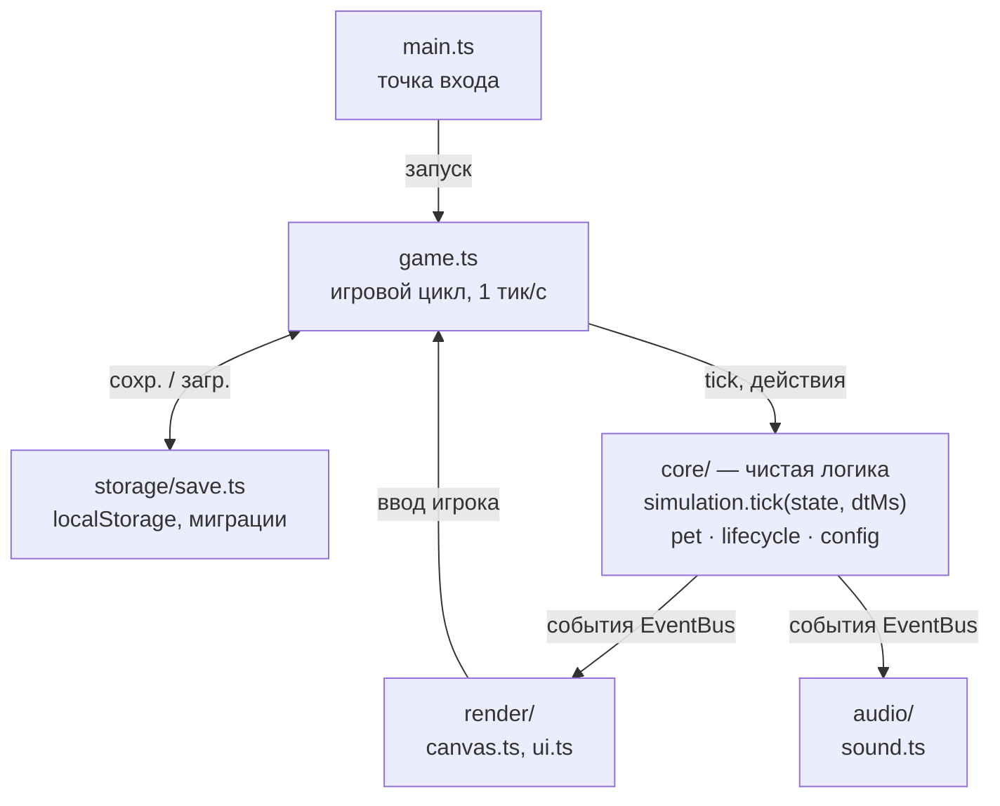

# ТЗ: игра «Тамагочи» для Android на TypeScript

Версия от 25.11.2026. Рабочая версия документа: https://claude.ai/artifact/FUjMhjV1jhm6MByMU7ihvS

## 1. Общие сведения

Цель — игра «Тамагочи» для Android-телефона на TypeScript без бэкенда: игрок заводит питомца, ухаживает за ним, и питомец растёт в реальном времени, даже когда приложение закрыто.

> С 25.11.2026 целевая платформа — только Android-приложение (Capacitor). Браузерная версия больше не развивается и не публикуется; дальнейшие требования пишутся под телефон.

| Параметр | Значение |
| --- | --- |
| Жанр | Казуальный симулятор виртуального питомца |
| Платформа | Android-телефон (приложение на Capacitor), портретная ориентация |
| Язык | TypeScript (strict) |
| Сервер | Не нужен, данные хранятся в localStorage |
| Аудитория | Игроки 10+, короткие сессии по 1–3 минуты несколько раз в день |
| Режим | Один игрок, один питомец одновременно (MVP) |

Вне рамок MVP: аккаунты, синхронизация между устройствами, мультиплеер, покупки.

## 2. Игровая механика

Питомец живёт за счёт пяти характеристик, которые со временем падают; задача игрока — держать их выше критического уровня. Все значения — целые числа от 0 до 100, скорости — стартовые, для балансировки выносятся в конфиг.

### 2.1 Характеристики

| Характеристика | Старт | Падение, ед./час | Что повышает |
| --- | --- | --- | --- |
| Сытость (hunger) | 80 | 8 | Кормление |
| Счастье (happiness) | 80 | 6 | Игра, лакомство |
| Энергия (energy) | 100 | 5 (во сне +15) | Сон |
| Здоровье (health) | 100 | Только при низких других показателях | Лекарство |

Правила взаимодействия:

- Если сытость или счастье ниже 20 — здоровье падает на 3 ед./час за каждый такой показатель (было 5, смягчено на этапе 4).
- Во сне сытость и счастье падают вдвое медленнее (добавлено на этапе 4, чтобы питомец переживал ночь).
- **Какашки** (с версии 1.4.0 вместо шкалы «Чистота», как в настоящем Тамагочи): появляются примерно раз в 3 часа (у малыша — раз в 2 часа), во сне вдвое реже, интервал плавает на ±30 минут. На полу видно до 6, копится до 9.
- 3 и больше какашек — питомец грустит и может заболеть (флаг `isSick`): здоровье падает быстрее, питомец отказывается играть.
- Больше 5 какашек — здоровье падает на 3 ед./час.
- При энергии ниже 10 питомец засыпает сам.
- Здоровье 0 — смерть.

### 2.2 Действия игрока

| Действие | Эффект | Ограничение |
| --- | --- | --- |
| Покормить едой | Сытость +25 | При сытости 100 — переедание: здоровье −10. Во сне недоступно |
| Дать лакомство | Счастье +15, сытость +5, тратит 1 лакомство | Нужны лакомства из мини-игр; больше 3 за час — здоровье −5; во сне недоступно |
| Поиграть | Открывает мини-игры; по итогу: счастье +20 (победа +30), энергия −10, сытость −5, при победе — лакомства | Недоступно во сне и при болезни |
| Уложить спать / разбудить | Переключает сон | Разбудить раньше времени — счастье −10 |
| Убрать | Убирает все какашки | Неактивна, если убирать нечего; доступна и во сне |
| Дать лекарство | Снимает болезнь, здоровье +30 | Без болезни — счастье −10 |

Действия имеют кулдаун 3–5 секунд, чтобы нельзя было «накликать» идеальные показатели.

### 2.3 Стадии жизни

1. Яйцо — 0–5 минут, характеристики не падают, игрок выбирает имя.
2. Малыш — до 1 дня, падение ×1,5 (часто просит есть).
3. Ребёнок — 1–3 дня.
4. Подросток — 3–6 дней.
5. Взрослый — 6–14 дней; внешний вид зависит от качества ухода (среднее счастье и число болезней): «хороший», «обычный» или «вредный».
6. Старость — после 14 дней, энергия падает ×2, естественная смерть на 16–20 день.

### 2.3.1 Виды животных

При создании игрок выбирает животное: кошечка, собачка или «Пушистик» (исходный персонаж). У каждого вида свой облик на всех стадиях и три облика взрослого; у кошки и собаки есть хвост, который виляет (быстрее — во время игры и еды, неподвижен во сне и в грусти). Правила ухода у всех видов одинаковые. Список видов расширяемый (см. README).

### 2.3.2 Мини-игры и лакомства

Лакомства — валюта: у нового питомца их 0, они зарабатываются в мини-играх и тратятся кнопкой «Лакомство». «Поиграть» открывает окно со списком игр.

**Судоку с питомцем** (головоломка типа Queens): поле N×N из N цветных зон; в каждой строке, столбце и зоне ровно один питомец, питомцы не касаются друг друга даже углами. Поле генерируется заново и всегда имеет единственное решение. Касание — крестик, двойное касание — поставить питомца. Ошибка отнимает одно из 3 сердечек и подсвечивает нарушенное правило; после верного хода невозможные клетки зачёркиваются автоматически. Награда: 5×5 — 1, 6×6 — 2, 7×7 — 3 лакомства.

### 2.4 Смерть и новая игра

После смерти показывается экран с итогами: имя, возраст, причина, достигнутая стадия. Запись уходит в «Зал памяти», кнопка «Новое яйцо» начинает игру заново.

## 3. Функциональные требования

Игра состоит из четырёх экранов и должна корректно считать время, прошедшее с последнего визита.

### 3.1 Экраны

| Экран | Содержимое |
| --- | --- |
| Стартовый | Логотип, «Новая игра» / «Продолжить», ввод имени питомца |
| Игровой | Питомец с анимацией, шкалы характеристик, возраст, панель действий |
| Итоги | Статистика жизни после смерти, кнопка «Новое яйцо» |
| Настройки | Звук вкл/выкл, уведомления, сброс сохранения, «Зал памяти» |

### 3.2 Интерфейс игрового экрана

- Питомец в центре, состояния анимации: idle, ест, играет, спит, болеет, грустит, умер.
- Шкалы характеристик с иконками; цвет зелёный (>60), жёлтый (30–60), красный (<30).
- Панель из 6 кнопок действий; недоступные и на кулдауне визуально заблокированы.
- Иконки потребностей над питомцем (голоден, грязно, болен) при значении ниже 30.
- Визуальный стиль — пиксель-арт в духе классических брелоков (оригинальные спрайты, без заимствования чужой графики).

### 3.3 Сохранение и офлайн-прогресс

- Состояние сохраняется в localStorage после каждого действия, раз в 10 секунд и на `visibilitychange`.
- Сейв содержит поле `version`; при загрузке старой версии выполняется миграция, при повреждении — безопасный сброс с сообщением.
- При открытии игра считает `Δt = now − lastUpdated` и прогоняет симуляцию шагами по 1 минуте, чтобы правила (болезнь, автосон, смерть) срабатывали как в реальном времени.
- Офлайн-прогресс ограничен 72 часами; время в будущем (перевод часов) игнорируется.
- После долгого отсутствия показывается сводка: «Пока тебя не было 5 часов, Пушок проголодался».

### 3.4 Звук и уведомления

- Короткие 8-битные звуки через Web Audio API, по умолчанию выключены до первого клика.
- В заголовке вкладки — индикатор тревоги (например, «(!) Тамагочи»), когда потребность ниже 20.
- Браузерные уведомления (Notification API) — опционально, только после разрешения игрока.

## 4. Технические требования

Игровая логика пишется на чистом TypeScript и не зависит от DOM — это позволяет покрыть её юнит-тестами и позже сменить рендерер.

### 4.1 Стек

| Часть | Выбор |
| --- | --- |
| Язык | TypeScript 5.x, `strict: true` |
| Сборка | Vite |
| Отрисовка | Canvas 2D (спрайты питомца) + HTML/CSS (интерфейс) |
| Фреймворк | Не обязателен; допускается Preact для UI |
| Тесты | Vitest |
| Качество кода | ESLint + Prettier |
| Хранение | localStorage (JSON) |
| Сборка | APK в GitHub Actions, релиз `android-latest` |

### 4.2 Структура проекта

```
src/
  core/        # чистая логика, без DOM
    pet.ts         # модель и действия
    simulation.ts  # tick(state, dtMs) → state
    lifecycle.ts   # стадии и эволюция
    config.ts      # скорости, пороги
  storage/
    save.ts        # сериализация, миграции
  render/
    canvas.ts      # спрайты, анимации
    ui.ts          # шкалы, кнопки, экраны
  audio/
    sound.ts
  game.ts          # игровой цикл, связка модулей
  main.ts          # точка входа
tests/
assets/sprites/
```

### 4.3 Модель данных

```typescript
type LifeStage = 'egg' | 'baby' | 'child' | 'teen' | 'adult' | 'elder' | 'dead';
type Mood = 'happy' | 'normal' | 'sad' | 'sick' | 'sleeping';

interface Stats {
  hunger: number;    // 0..100
  happiness: number;
  energy: number;
  hygiene: number;
  health: number;
}

interface Pet {
  name: string;
  stage: LifeStage;
  stats: Stats;
  bornAt: number;        // timestamp, мс
  isSleeping: boolean;
  isSick: boolean;
  careScore: number;     // влияет на эволюцию
  causeOfDeath?: 'hunger' | 'sickness' | 'neglect' | 'oldAge';
}

interface SaveData {
  version: number;
  pet: Pet | null;
  lastUpdated: number;
  cooldowns: Record<ActionType, number>;
  settings: { sound: boolean; notifications: boolean };
  graveyard: Array<Pick<Pet, 'name' | 'stage' | 'bornAt' | 'causeOfDeath'> & { diedAt: number }>;
}

type ActionType = 'feed' | 'snack' | 'play' | 'sleep' | 'clean' | 'medicine';
```

### 4.4 Архитектурные правила

- `simulation.tick(state, dtMs)` — чистая функция: не читает `Date.now()`, не трогает DOM, возвращает новое состояние.
- Симуляция обновляется раз в 1 секунду, анимация — через `requestAnimationFrame` независимо от логики.
- Игровые события (заболел, вырос, умер) передаются через типизированный EventBus; UI и звук подписываются на них.
- Все числа баланса — только в `config.ts`, без «магических чисел» в коде.
- В dev-режиме — панель отладки: ускорение времени ×10/×100, ручная установка характеристик.



game.ts — единственный модуль, который знает обо всех: он вызывает ядро и сохранение, а рендер и звук только реагируют на события ядра.

## 5. Нефункциональные требования

Игра должна быстро грузиться и одинаково работать на телефоне и компьютере.

| Требование | Показатель |
| --- | --- |
| Размер сборки | До 500 КБ вместе с графикой |
| Загрузка | До 2 с на 4G |
| Анимация | 60 FPS на среднем смартфоне |
| Экраны | От 320 px в ширину, портретная ориентация — основная |
| Браузеры | Последние 2 версии Chrome, Firefox, Safari, Edge; iOS Safari 16+ |
| Управление | Мышь, тач, клавиатура (горячие клавиши 1–6) |
| Кнопки | Не менее 44×44 px |
| Доступность | `aria-label` на кнопках, шкалы через `role="progressbar"`, состояние не передаётся только цветом |
| Надёжность | Нет потери прогресса при закрытии вкладки и перезагрузке |
| Тесты | Покрытие `src/core` не менее 80% |
| Язык интерфейса | Русский; строки вынесены в отдельный файл для перевода |

## 6. Этапы и приёмка

Работа делится на четыре этапа; каждый заканчивается играбельной сборкой.

1. **Ядро** — модель питомца, `tick`, действия, сохранение, юнит-тесты. UI — простые HTML-кнопки и текст.
2. **Графика и интерфейс** — спрайты, анимации состояний, шкалы, адаптивная вёрстка.
3. **Жизненный цикл** — стадии, эволюция, болезни, смерть, офлайн-прогресс, «Зал памяти».
4. **Полировка** — звук, уведомления, настройки, баланс, деплой.

### Критерии приёмки

- [ ] `npm run build` и `npm test` проходят без ошибок, `tsc --noEmit` — без предупреждений
- [ ] Все 6 действий работают согласно таблице 2.2, кулдауны соблюдаются
- [ ] После закрытия вкладки на N часов характеристики совпадают с симуляцией на N часов (тест)
- [ ] Питомец проходит все стадии в режиме ускорения времени
- [ ] Смерть наступает только при здоровье 0 или старости, итоги сохраняются в «Зал памяти»
- [ ] Повреждённый сейв не ломает игру
- [ ] Интерфейс корректен на ширине 320 px и на десктопе

### Идеи на будущее

- Мини-игры вместо простой кнопки «Играть» (угадай направление, ловля еды)
- Игровая валюта, магазин еды и игрушек
- PWA: установка на рабочий стол, push-уведомления через Service Worker
- Смена дня и ночи по реальному времени
- Несколько видов питомцев и достижения
