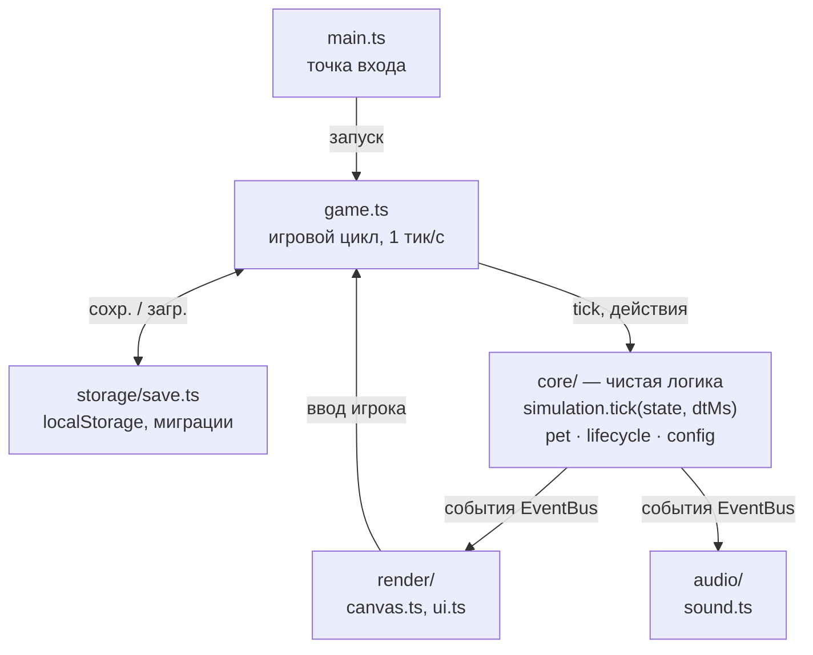

# ТЗ: игра «Тамагочи» для Android на TypeScript

Версия от 25.11.2026. Рабочая версия документа: https://claude.ai/artifact/FUjMhjV1jhm6MByMU7ihvS

## 1. Общие сведения

Цель — игра «Тамагочи» для Android-телефона на TypeScript без бэкенда: игрок заводит питомца, ухаживает за ним, и питомец растёт в реальном времени, даже когда приложение закрыто.

> С 25.11.2026 целевая платформа — только Android-приложение (Capacitor). Браузерная версия больше не развивается и не публикуется; дальнейшие требования пишутся под телефон.

| Параметр | Значение |
| --- | --- |
| Жанр | Казуальный симулятор виртуального питомца |
| Платформа | Android-телефон (приложение на Capacitor), портретная ориентация |
| Язык | TypeScript (strict) |
| Сервер | Не нужен, данные хранятся в localStorage |
| Аудитория | Игроки 10+, короткие сессии по 1–3 минуты несколько раз в день |
| Режим | Один игрок, один питомец одновременно (MVP) |

Вне рамок MVP: аккаунты, синхронизация между устройствами, мультиплеер, покупки.

## 2. Игровая механика

Питомец живёт за счёт пяти характеристик, которые со временем падают; задача игрока — держать их выше критического уровня. Все значения — целые числа от 0 до 100, скорости — стартовые, для балансировки выносятся в конфиг.

### 2.1 Характеристики

| Характеристика | Старт | Падение, ед./час | Что повышает |
| --- | --- | --- | --- |
| Сытость (hunger) | 80 | 8 | Кормление |
| Счастье (happiness) | 80 | 6 | Игра, лакомство |
| Энергия (energy) | 100 | 5 (во сне +15) | Сон |
| Здоровье (health) | 100 | Только при низких других показателях | Лекарство |

Правила взаимодействия:

- Если сытость или счастье ниже 20 — здоровье падает на 3 ед./час за каждый такой показатель (было 5, смягчено на этапе 4).
- Во сне сытость и счастье падают вдвое медленнее (добавлено на этапе 4, чтобы питомец переживал ночь).
- **Какашки** (с версии 1.4.0 вместо шкалы «Чистота», как в настоящем Тамагочи): появляются примерно раз в 3 часа (у малыша — раз в 2 часа), во сне вдвое реже, интервал плавает на ±30 минут. На полу видно до 6, копится до 9.
- 3 и больше какашек — питомец грустит и может заболеть (флаг `isSick`): здоровье падает быстрее, питомец отказывается играть.
- Больше 5 какашек — здоровье падает на 3 ед./час.
- При энергии ниже 10 питомец засыпает сам.
- Здоровье 0 — смерть.

### 2.2 Действия игрока

| Действие | Эффект | Ограничение |
| --- | --- | --- |
| Покормить едой | Сытость +25 | При сытости 100 — переедание: здоровье −10. Во сне недоступно |
| Дать лакомство | Счастье +15, сытость +5, тратит 1 лакомство | Нужны лакомства из мини-игр; больше 3 за час — здоровье −5; во сне недоступно |
| Поиграть | Открывает мини-игры; по итогу: счастье +20 (победа +30), энергия −10, сытость −5, при победе — лакомства | Недоступно во сне и при болезни |
| Уложить спать / разбудить | Переключает сон | Разбудить раньше времени — счастье −10 |
| Убрать | Убирает все какашки | Неактивна, если убирать нечего; доступна и во сне |
| Дать лекарство | Снимает болезнь, здоровье +30 | Без болезни — счастье −10 |

Действия имеют кулдаун 3–5 секунд, чтобы нельзя было «накликать» идеальные показатели.

### 2.3 Стадии жизни

1. Яйцо — 0–5 минут, характеристики не падают, игрок выбирает имя.
2. Малыш — до 1 дня, падение ×1,5 (часто просит есть).
3. Ребёнок — 1–3 дня.
4. Подросток — 3–6 дней.
5. Взрослый — 6–14 дней; внешний вид зависит от качества ухода (среднее счастье и число болезней): «хороший», «обычный» или «вредный».
6. Старость — после 14 дней, энергия падает ×2, естественная смерть на 16–20 день.

### 2.3.1 Виды животных

При создании игрок выбирает животное: кошечка, собачка или «Пушистик» (исходный персонаж). У каждого вида свой облик на всех стадиях и три облика взрослого; у кошки и собаки есть хвост, который виляет (быстрее — во время игры и еды, неподвижен во сне и в грусти). Правила ухода у всех видов одинаковые. Список видов расширяемый (см. README).

### 2.3.2 Мини-игры и лакомства

Лакомства — валюта: у нового питомца их 0, они зарабатываются в мини-играх и тратятся кнопкой «Лакомство». «Поиграть» открывает окно со списком игр.

**Судоку с питомцем** (головоломка типа Queens): поле N×N из N цветных зон; в каждой строке, столбце и зоне ровно один питомец, питомцы не касаются друг друга даже углами. Поле генерируется заново и всегда имеет единственное решение. Касание — крестик; провести пальцем по клеткам — крестики вслед за пальцем (если начать с крестика — стирает); двойное касание — поставить питомца. Ошибка отнимает одно из 3 сердечек и подсвечивает нарушенное правило. Крестики игрок ставит сам — автоматически ничего не зачёркивается (с версии 1.5.1). Награда: 6×6 — 1, 8×8 — 2, 10×10 — 3 лакомства (с версии 1.6.0). Для каждого уровня считаются сыгранные и выигранные партии (учитывается только законченная партия; счётчики хранятся отдельно от питомца и не сбрасываются его смертью) — они видны в списке уровней.

**Питомцы-блоки (с версии 1.7.0)** — в духе Haru Cats Slide. Поле 10×10. В каждой полосе лежат горизонтальные блоки длиной 1–4 клетки с мордочкой питомца игрока; в новой полосе занято 3–6 клеток и всегда есть дырка. Игра начинается с тремя нижними полосами. Ход — сдвинуть пальцем один блок влево или вправо по свободным клеткам его полосы (перепрыгивать соседей нельзя). После хода: блоки, под которыми целиком пусто, падают; заполненная полоса исчезает, верхние опускаются (цепочки считаются); затем сверху падает новая полоса (её видно заранее над полем — «Дальше упадёт»). Если стопка дорастает до верхней полосы — игра окончена. Раз в 15–20 новых полос на одном из блоков лежит лакомство; когда этот блок исчезает вместе с полосой, лакомство сразу начисляется (сохраняется немедленно, не теряется при выходе). Выйти посреди партии можно — партия засчитывается. Счётчики: сыграно и рекорд убранных полос; победой считается партия, где добыто хоть одно лакомство (она даёт и бонус к счастью). Логика — `src/core/slide.ts` (детерминирована по seed, тесты в `tests/slide.test.ts`), экран — `src/render/slide.ts`.

**Языки (с версии 1.6.0).** Интерфейс на русском и английском; язык выбирается в «Настройках» (при первом запуске — по языку телефона: русский → русский, иначе английский). Тексты лежат в `src/lang/ru.ts` и `src/lang/en.ts` одной формы (тест проверяет совпадение), `src/strings.ts` отдаёт «живые» ссылки на текущий язык. После смены языка приложение перезапускается на экране настроек. Чтобы добавить язык: новый файл `src/lang/xx.ts` типа `Dict`, строка в `LANGUAGES` и `DICTS` в `src/i18n.ts`. Название значка приложения на телефоне остаётся «Тамагочи».

Сохранение — версия 5: `settings.language` и `gameStats`.

### 2.4 Смерть и новая игра

После смерти показывается экран с итогами: имя, возраст, причина, достигнутая стадия. Запись уходит в «Зал памяти», кнопка «Новое яйцо» начинает игру заново.

## 3. Функциональные требования

Игра состоит из четырёх экранов и должна корректно считать время, прошедшее с последнего визита.

### 3.1 Экраны

| Экран | Содержимое |
| --- | --- |
| Стартовый | Логотип, «Новая игра» / «Продолжить», ввод имени питомца |
| Игровой | Питомец с анимацией, шкалы характеристик, возраст, панель действий |
| Итоги | Статистика жизни после смерти, кнопка «Новое яйцо» |
| Настройки | Звук вкл/выкл, уведомления, сброс сохранения, «Зал памяти» |

### 3.2 Интерфейс игрового экрана

- Питомец в центре, состояния анимации: idle, ест, играет, спит, болеет, грустит, умер.
- Шкалы характеристик с иконками; цвет зелёный (>60), жёлтый (30–60), красный (<30).
- Панель из 6 кнопок действий; недоступные и на кулдауне визуально заблокированы.
- Иконки потребностей над питомцем (голоден, грязно, болен) при значении ниже 30.
- Визуальный стиль — пиксель-арт в духе классических брелоков (оригинальные спрайты, без заимствования чужой графики).

### 3.3 Сохранение и офлайн-прогресс

- Состояние сохраняется в localStorage после каждого действия, раз в 10 секунд и на `visibilitychange`.
- Сейв содержит поле `version`; при загрузке старой версии выполняется миграция, при повреждении — безопасный сброс с сообщением.
- При открытии игра считает `Δt = now − lastUpdated` и прогоняет симуляцию шагами по 1 минуте, чтобы правила (болезнь, автосон, смерть) срабатывали как в реальном времени.
- Офлайн-прогресс ограничен 72 часами; время в будущем (перевод часов) игнорируется.
- После долгого отсутствия показывается сводка: «Пока тебя не было 5 часов, Пушок проголодался».

### 3.4 Звук и уведомления

- Короткие 8-битные звуки через Web Audio API, по умолчанию выключены до первого клика.
- В заголовке вкладки — индикатор тревоги (например, «(!) Тамагочи»), когда потребность ниже 20.
- Браузерные уведомления (Notification API) — опционально, только после разрешения игрока.

## 4. Технические требования

Игровая логика пишется на чистом TypeScript и не зависит от DOM — это позволяет покрыть её юнит-тестами и позже сменить рендерер.

### 4.1 Стек

| Часть | Выбор |
| --- | --- |
| Язык | TypeScript 5.x, `strict: true` |
| Сборка | Vite |
| Отрисовка | Canvas 2D (спрайты питомца) + HTML/CSS (интерфейс) |
| Фреймворк | Не обязателен; допускается Preact для UI |
| Тесты | Vitest |
| Качество кода | ESLint + Prettier |
| Хранение | localStorage (JSON) |
| Сборка | APK в GitHub Actions, релиз `android-latest` |

### 4.2 Структура проекта

```
src/
  core/        # чистая логика, без DOM
    pet.ts         # модель и действия
    simulation.ts  # tick(state, dtMs) → state
    lifecycle.ts   # стадии и эволюция
    config.ts      # скорости, пороги
  storage/
    save.ts        # сериализация, миграции
  render/
    canvas.ts      # спрайты, анимации
    ui.ts          # шкалы, кнопки, экраны
  audio/
    sound.ts
  game.ts          # игровой цикл, связка модулей
  main.ts          # точка входа
tests/
assets/sprites/
```

### 4.3 Модель данных

```typescript
type LifeStage = 'egg' | 'baby' | 'child' | 'teen' | 'adult' | 'elder' | 'dead';
type Mood = 'happy' | 'normal' | 'sad' | 'sick' | 'sleeping';

interface Stats {
  hunger: number;    // 0..100
  happiness: number;
  energy: number;
  hygiene: number;
  health: number;
}

interface Pet {
  name: string;
  stage: LifeStage;
  stats: Stats;
  bornAt: number;        // timestamp, мс
  isSleeping: boolean;
  isSick: boolean;
  careScore: number;     // влияет на эволюцию
  causeOfDeath?: 'hunger' | 'sickness' | 'neglect' | 'oldAge';
}

interface SaveData {
  version: number;
  pet: Pet | null;
  lastUpdated: number;
  cooldowns: Record<ActionType, number>;
  settings: { sound: boolean; notifications: boolean };
  graveyard: Array<Pick<Pet, 'name' | 'stage' | 'bornAt' | 'causeOfDeath'> & { diedAt: number }>;
}

type ActionType = 'feed' | 'snack' | 'play' | 'sleep' | 'clean' | 'medicine';
```

### 4.4 Архитектурные правила

- `simulation.tick(state, dtMs)` — чистая функция: не читает `Date.now()`, не трогает DOM, возвращает новое состояние.
- Симуляция обновляется раз в 1 секунду, анимация — через `requestAnimationFrame` независимо от логики.
- Игровые события (заболел, вырос, умер) передаются через типизированный EventBus; UI и звук подписываются на них.
- Все числа баланса — только в `config.ts`, без «магических чисел» в коде.
- В dev-режиме — панель отладки: ускорение времени ×10/×100, ручная установка характеристик.



game.ts — единственный модуль, который знает обо всех: он вызывает ядро и сохранение, а рендер и звук только реагируют на события ядра.

## 5. Нефункциональные требования

Игра должна быстро грузиться и одинаково работать на телефоне и компьютере.

| Требование | Показатель |
| --- | --- |
| Размер сборки | До 500 КБ вместе с графикой |
| Загрузка | До 2 с на 4G |
| Анимация | 60 FPS на среднем смартфоне |
| Экраны | От 320 px в ширину, портретная ориентация — основная |
| Браузеры | Последние 2 версии Chrome, Firefox, Safari, Edge; iOS Safari 16+ |
| Управление | Мышь, тач, клавиатура (горячие клавиши 1–6) |
| Кнопки | Не менее 44×44 px |
| Доступность | `aria-label` на кнопках, шкалы через `role="progressbar"`, состояние не передаётся только цветом |
| Надёжность | Нет потери прогресса при закрытии вкладки и перезагрузке |
| Тесты | Покрытие `src/core` не менее 80% |
| Язык интерфейса | Русский; строки вынесены в отдельный файл для перевода |

## 6. Этапы и приёмка

Работа делится на четыре этапа; каждый заканчивается играбельной сборкой.

1. **Ядро** — модель питомца, `tick`, действия, сохранение, юнит-тесты. UI — простые HTML-кнопки и текст.
2. **Графика и интерфейс** — спрайты, анимации состояний, шкалы, адаптивная вёрстка.
3. **Жизненный цикл** — стадии, эволюция, болезни, смерть, офлайн-прогресс, «Зал памяти».
4. **Полировка** — звук, уведомления, настройки, баланс, деплой.

### Критерии приёмки

- [ ] `npm run build` и `npm test` проходят без ошибок, `tsc --noEmit` — без предупреждений
- [ ] Все 6 действий работают согласно таблице 2.2, кулдауны соблюдаются
- [ ] После закрытия вкладки на N часов характеристики совпадают с симуляцией на N часов (тест)
- [ ] Питомец проходит все стадии в режиме ускорения времени
- [ ] Смерть наступает только при здоровье 0 или старости, итоги сохраняются в «Зал памяти»
- [ ] Повреждённый сейв не ломает игру
- [ ] Интерфейс корректен на ширине 320 px и на десктопе

### Идеи на будущее

- Мини-игры вместо простой кнопки «Играть» (угадай направление, ловля еды)
- Игровая валюта, магазин еды и игрушек
- PWA: установка на рабочий стол, push-уведомления через Service Worker
- Смена дня и ночи по реальному времени
- Несколько видов питомцев и достижения

**Графика из PixelLab (с версии 1.8.0).** Иконка приложения (`art/app-icon.png`, 64×64) и цветные иконки интерфейса (`art/ui/*.png`, 32×32: показатели, кнопки действий, какашка, зал памяти, настройки, лакомство в мини-играх, мордочки кошечки, собачки и пушистика `face_*.png` для мини-игр) нарисованы в сервисе PixelLab в общем пастельном пиксель-стиле. Иконки собираются в `src/render/artData.ts` командой `node scripts/art-data.mjs`; иконки Android — из `art/app-icon.png` скриптом `scripts/android-icons.mjs`. Название приложения под значком зависит от языка телефона: «Тамагочи» на русском, «Tamagotchi» на остальных (`scripts/android-strings.mjs`).

**Цветной питомец и фон по времени суток (с версии 1.9.0).** Экран питомца больше не «жидкокристаллический»: тела всех трёх животных на всех стадиях (малыш, ребёнок, подросток, три вида взрослого, старик), яйцо, треснувшее яйцо, надгробие и бабочка нарисованы в PixelLab (`art/pets/*.png`, 64×64 на кадр, 9 кадров в строке). Строки листа: покой, сон, еда; у взрослых «хороший» облик ещё болезнь, голод и усталость (у остальных стадий они играют покой). Листы собирает `python3 scripts/pets-build.py <папка с выдачей>` по описанию `art/pets-src.json`, размеры и опорные точки лежат в `src/render/petMeta.ts`. Логика сцены (`scene.ts`) по-прежнему чистая функция: она выбирает строку анимации и кадр, а `canvas.ts` рисует их поверх фона.

Режим ожидания: 14 с питомец гуляет, затем 8 с охотится за бабочкой (цикл 22 с). Кошка прыгает и ловит лапами, собака подпрыгивает и хватает зубами, пушистик бегает под бабочкой кругами. При «уменьшить анимации» бабочки нет. Грустный питомец показывает голод или усталость, смотря что ниже порога.

Фон (`src/render/backdrop.ts`) зависит от местного времени: утром светло-жёлтое свечение в левом верхнем углу, к вечеру оно смещается к правому, закат розовеет, ночью фон тёмно-синий, а свет бледно-белый, как от луны. Время берётся с телефона, цвет пересчитывается раз в минуту.

Мелкие предметы (миска, мяч, сердечко, пузыри, какашки) пока остаются прежними спрайтами, перекрашенными в цвет; их тоже можно перерисовать в PixelLab.

**Бонусы «Питомцев-блоков» (с версии 1.10.0).** Раз в 3–5 ходов на одном из блоков новой полосы лежит случайный бонус (не на блоке с лакомством). Бонус достаётся, когда исчезает его блок.
- Заморозка: уходит в запас, под полем появляется кнопка. После нажатия 3 хода подряд новые полосы не падают (поле подёрнуто льдом, рядом счётчик ходов); заморозки складываются.
- Молния срабатывает, когда исчезает её полоса: вместе с ней пропадают блоки, которые касались блока с молнией сверху и снизу (лакомства и бонусы на них тоже засчитываются). Цепной реакции нет.
- Крошки: в запасе, кнопка под полем. Нажатие бесплатное (ход не тратится, полоса не падает): выбирается поле 3×3 с наибольшим числом клеток длинных блоков (при равенстве случайное), блоки внутри него становятся одиночными клетками, части блока вне поля остаются целыми, лакомство или бонус остаются на левом куске. Если длинных блоков нет, крошки не тратятся.
Иконки бонусов нарисованы в PixelLab (`art/ui/bonus_*.png`). Логика в `src/core/slide.ts` (`useFreeze`, `useCrumbs`, `resolve`).


**Версия 1.11.0.**
- Плавные анимации всех стадий кошки, собаки и пушистика: спокойный «idle», прогулка боком, еда из миски (подходит к миске, наклоняется), лежание с покачиванием хвоста (кошка/собака — ещё и кувырок), ловля лакомства в прыжке, сон с редким подёргиванием. Недостающие строки листа заменяются старыми (`idle`, `sleep`, `eat`).
- Цветные предметы: лакомство, какашка с зелёным дымком, лекарство, миска.
- Бабочка прилетает редко — раз в ~75 с.
- «Питомцы-блоки»: поле 8×10, бонусы каждые 3–5 ходов (кнопки-иконки всегда видны, без бонуса неактивны), лакомство каждые 10–15 ходов, два режима — «Лавина» (блоки падают сверху) и «Прилив» (новые блоки поднимаются снизу); в шапке игры убрана иконка питомца.

**Версия 1.11.1.** В режиме тестирования на корпусе (над экраном) есть кнопка «Анимации»: список всех строк анимации, выбранная крутится у питомца по кругу; «Обычное поведение» возвращает игру в норму.

**Версия 1.11.2.** «Питомцы-блоки»: бонус раз в 4–7 полос, лакомство раз в 15–20 (как в версии 1.10.0). После «крошек» осколки падают на свободные места, полные полосы исчезают. Партия сохраняется при выходе (и после каждого хода) и продолжается при следующем входе в тот же режим; сохранение стирается, когда партия закончена.

**Версия 1.11.3.**
- Питомцы на 50 % крупнее (`PET_SCALE` в `sprites.ts`, масштаб рисования `cell/3`); элементы сцены удерживаются в экране (`keepOnScreen`).
- Заново нарисованы «спокойные» покой, ходьба и лежание (`idle_calm`, `walk_calm`, `lie_calm`) — рот почти не двигается; играются вместо прежних строк, если они есть у стадии. Рот двигать в коде нельзя: он рисуется генератором в каждом кадре, у части стадий ещё остаётся лёгкое движение.
- Кувырок (`roll`) есть у всех 21 стадии.
- Больной, голодный и уставший питомец лежит грустным (`lie_sad`, 17 кадров).
- «Питомцы-блоки»: после выхода из партии и возврата счётчик лакомств равен 0 (они уже получены).
- `scripts/pets-build.py` принимает несколько дополнительных листов (`extras`) на стадию.

**Версия 1.11.4.** В списке анимаций (режим тестирования) можно выбрать вид питомца: «Мой питомец», кошечка, собачка, пушистик — выбранная анимация крутится у него.

**Версия 1.11.5.** В списке анимаций (режим тестирования) можно выбрать стадию: малыш, ребёнок, подросток, взрослый (хороший/обычный/озорной), старичок; вид и стадия показываются на кнопке.

**Версия 1.12.0. Новая мини-игра «Мозаика».** Картинка из цветных кубиков (пока одна — сердечко 10×9, 4 цвета). Внизу четыре очереди баночек с числами; тап по первой баночке ставит её в одну из 4 ячеек, и питомец уносит в норку по одному открытому кубику её цвета за шаг (кубик открыт, если рядом пусто или край картинки; сначала ближайшие к норке). Числа на баночках каждого цвета в сумме равны числу кубиков цвета. Победа — картинка пуста: +3 лакомства. Тупик — все ячейки заняты и ничего нельзя унести: можно начать заново. Логика — `src/core/mosaic.ts`, экран — `src/render/mosaic.ts`, счётчики — `gameStats.mosaic`.

**Версия 1.13.0. Стадии без подростка.** Яйцо 10 минут, малыш 1 день, ребёнок 4 дня, взрослый 20 дней, старичок 5 дней (всего 30 дней и 10 минут, срок жизни больше не случайный). Взрослый рисуется картинкой бывшего «подростка» (все три формы выглядят одинаково; форма по-прежнему считается по уходу). Старичок пока прежний — будет перерисован от нового взрослого. Сохранения версии 5 переезжают в 6 (срок жизни продлевается, стадия пересчитывается по возрасту). В списке анимаций оставлены только нужные: покой, ходьба, лежит, кувырок, еда боком, ловит лакомство, сон, грусть (одна для болезни, голода и усталости).

### 1.13.1
- Мозаика: питомцы бегут к норке не по диагонали, а по прямым — к ближайшему краю картинки, вокруг неё и к норке (вперёд, вправо, влево, назад).

### 1.13.2
- Мозаика: питомец сначала бежит из норки за своим кубиком по прямым, берёт его и несёт обратно; питомец стал вдвое меньше.

### 1.13.3
- Мозаика: питомец выбегает из выбранного кубика (а не из норки) и уносит его в норку по прямым; размер вдвое меньше.

### 1.13.4
- Мозаика: питомец бежит только по свободным от кубиков местам и обегает мозаику (поиск пути по пустым клеткам с минимумом поворотов).

### 1.13.5
- Мозаика: питомец выбегает из выбранной баночки, без груза бежит к кубику по свободным местам, берёт его и несёт в норку.

### 1.13.6
- Мозаика: с грузом питомец бежит от кубика прямо к норке, без боковых пробежек под мозаикой.

### 1.14.0
- «Мозаика» переименована в «Питомцы-воришки».
- Новая мини-игра «Бухта питомцев»: острова с 1–4 питомцами (5/40/40/15 %) всплывают снизу, три корабля сверху, пристань на 5 мест. Нажатый питомец плывёт на корабль своего вида или ждёт на пристани и пересаживается, когда корабль появится. Три одинаковых — корабль отплывает. Пустые острова исчезают, остальные поднимаются на свободное место. Проигрыш: пристань полна и отправить некого. 8 видов питомцев (три зверя в трёх возрастах), 72 питомца, награда 3 лакомства. В симуляции случайная игра выигрывает около 84 % партий.

### 1.14.1
- Бухта питомцев: острова — свободные пузыри разного размера (радиус зависит от числа питомцев), всплывают и скапливаются сверху вместо сетки 3×4; видов питомцев 9, всего 81. Полный корабль уплывает вверх, новый появляется, когда прежний уже пропал.

### 1.14.2
- Бухта питомцев: острова снова песочного цвета с зелёной серединой; пузыри плотнее, касаются краями (прижимаются к ближайшему препятствию); поле подогнано по высоте экрана, прокрутки нет; новый корабль появляется только после ухода старого (корабли не перерисовываются на каждом шаге воды).

### 1.15.0
- Бухта питомцев: размер острова не уменьшается, когда с него убирают питомцев (питомцы остаются на своих местах); острова рисуются чуть больше и плотнее касаются.
- Бонусы: около 14 процентов островов несут бонус, он достаётся, когда с острова убраны все питомцы. Сачок выуживает питомца вида, которого на кораблях больше всего. Удалить переносит питомцев с пристани в общий блок справа (5 мест), откуда они пересаживаются на корабли так же, как с пристани. Обновить перемешивает питомцев на островах. Кнопки бонусов под полем со счётчиками. Видов питомцев 8 (72 питомца). Партия проиграна, только если пристань полна, отправить некого и нечем спастись (Обновить или Удалить).

### 1.15.1
- Бухта питомцев: общий блок меньше, питомцы из «Удаления» лежат кучкой (без предела, со счётчиком); острова рисуются точно по кругу и не налезают друг на друга; укладка островов плотнее (мелкие шаги, скатывание по соседям, прижим к стенке); кнопки бонусов компактнее; новый значок сачка. Радиусы островов подобраны заново (случайная игра без бонусов выигрывает около 72 процентов).

### 1.16.0
- Бухта питомцев: партия сохраняется при выходе и продолжается при следующем входе (как в «Питомцах-блоках»); лакомства лежат на некоторых островах (около 12 процентов, остров несёт либо бонус, либо лакомство) и достаются сразу, когда остров опустел; награды за победу больше нет, счётчик лакомств в шапке.
- Острова ищут свободное место сбоку, если сверху их не пускают соседи (ищут точку, где потолок выше); значок бонуса на острове без чёрного кружка; новые значки бонусов: сачок, кисть, пропеллер.

### 1.16.1

- Бухта питомцев: круги с питомцами одного размера на островах любой величины (раньше размер считался в долях острова).

### 1.16.2

- Бухта питомцев: питомцы на пристани и в блоке «Удалить» больше не мигают при нажатии на питомца на острове (лица остающихся не пересоздаются).

### 1.16.3

- Бухта питомцев: остров у верхнего края, мешающий нижнему соседу подняться, сдвигается в свободную сторону (раньше упирался в него и стоял, оставляя пустоту).

### 1.17.0

- «Питомцы-воришки»: 21 новая картинка с питомцами (кот, пёс и блоб всех возрастов; сделаны из их спрайтов скриптом scripts/mosaic-from-pets.py), картинки крупнее (до 14 клеток вместо 10, около 135 кубиков вместо 90), в меню выбора — сетка с превью. Пустые клетки картинки не рисуются. Фон поля подкрашен, чтобы кремовые кубики были видны.

### 1.17.1

- «Питомцы-воришки»: питомцы снова обегают кубики — путь строится по тому, что видно на поле (кубик, который уже взят, но ещё не убран с экрана, тоже препятствие).
- Картинка выбирается случайно при каждой партии, выбор убран; счёт общий.
- Поле подгоняется по высоте экрана, страница не прокручивается.

### 1.17.2

- «Питомцы-воришки»: если к кубику пока нет свободного пути (соседние кубики ещё видны на поле), питомец ждёт, а не бежит напрямик через мозаику. Замер в браузере: проходов сквозь видимые кубики 1 против 127 за партию.

### 1.17.3

- «Питомцы-воришки»: питомец берёт ближайший к своей ячейке кубик нужного цвета (по длине пути в обход кубиков), а не ближайший к норке.

### 1.18.0

- «Питомцы-воришки»: картинки вдвое крупнее по каждой стороне (питомцы до 24 клеток, с фоном около 26 × 26; сердечко ×2), с фоном из неба и земли и до 9 цветов вместо 4. Ячеек теперь 5.
- Связанные баночки (около 10%): берутся из очереди только вместе (нужны две свободные ячейки, берутся рядом, если можно), уходят из ячеек тоже вместе — опустевшая ждёт вторую. Соединение рисуется трубкой цвета обеих. Тупик теперь — когда ни одна баночка не может ничего унести и ни одну нельзя взять.
- Питомцы крупнее относительно клетки, шаг игры быстрее.

### 1.18.1

- «Питомцы-воришки»: баночки в очередях плавно поднимаются вверх, когда верхняя уходит в ячейку; взятая летит в ячейку, открывшаяся снизу выезжает. Трубки на время движения скрываются.

### 1.18.2

- «Питомцы-воришки»: питомцы бегают на треть медленнее и теперь не крупнее клетки картинки (раньше при мелких клетках перекрывали соседние кубики, хотя шли по свободным).

### 1.18.3

- «Питомцы-воришки»: когда ячейка освобождается, баночки справа сдвигаются влево — свободные места всегда справа. Связанная пара всегда лежит в соседних ячейках, трубка больше не тянется через чужие баночки.

### 1.19.0

- «Питомцы-воришки»: кубик пропадает (и открывает соседей) только когда питомец его взял, а не когда за ним побежали; питомцы выходят сразу, без задержки в несколько секунд. Брать можно только кубики, до которых есть свободный путь (закрытые пустоты не считаются).
- Питомцы бегают вдвое медленнее; кнопка скорости ×1/×2/×3 рядом со счётчиком ускоряет бег и темп игры.

### 1.19.1

- Питомцы-воришки: число на баночке уменьшается только когда питомец действительно выбежал (баночка не берёт кубик, пока для него нет свободного пути).
- Трубы между связанными баночками больше не мигают: при движении баночек они едут вместе с ними.

### 1.19.2

- Питомцы-воришки: баночки в очереди — простые блоки, выступ сверху только у баночек в активной зоне; блёклые, но не прозрачные, поэтому труба между связанными баночками в очереди выглядит как в активной зоне.
- Баночки в очереди того же размера, что и в активной зоне; полоса очереди уже.

### 1.20.0

- Питомцы-воришки: из каждой баночки за шаг выбегают до двух питомцев — получается цепочка, как в образце. Маршруты и так идут к ближайшему краю картинки; связанные баночки соединены перемычкой между краями баночек, в том числе в разных столбцах.

### 1.20.1

- Питомцы-воришки: связанные баночки можно вынести в активную зону, только когда обе лежат самыми верхними в своих столбцах. При создании партии связи, которые блокировали бы друг друга, разрываются.
