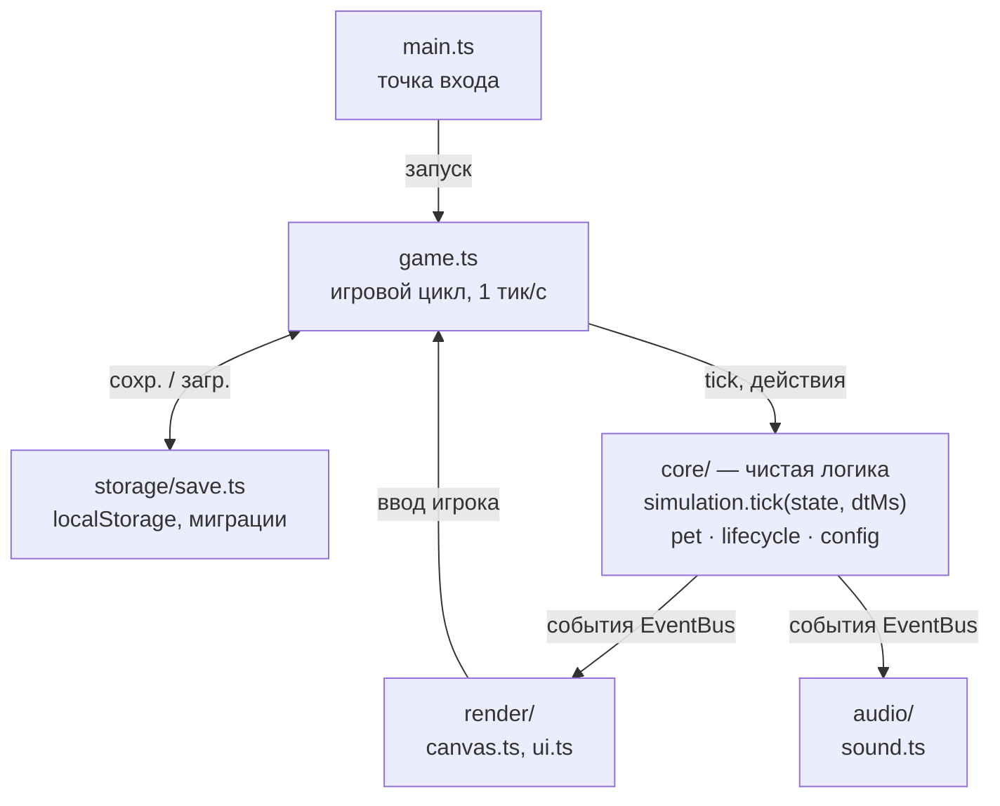

# ТЗ: игра «Тамагочи» для Android на TypeScript

Версия от 25.11.2026. Рабочая версия документа: https://claude.ai/artifact/FUjMhjV1jhm6MByMU7ihvS

## 1. Общие сведения

Цель — игра «Тамагочи» для Android-телефона на TypeScript без бэкенда: игрок заводит питомца, ухаживает за ним, и питомец растёт в реальном времени, даже когда приложение закрыто.

> С 25.11.2026 целевая платформа — только Android-приложение (Capacitor). Браузерная версия больше не развивается и не публикуется; дальнейшие требования пишутся под телефон.

| Параметр | Значение |
| --- | --- |
| Жанр | Казуальный симулятор виртуального питомца |
| Платформа | Android-телефон (приложение на Capacitor), портретная ориентация |
| Язык | TypeScript (strict) |
| Сервер | Не нужен, данные хранятся в localStorage |
| Аудитория | Игроки 10+, короткие сессии по 1–3 минуты несколько раз в день |
| Режим | Один игрок, один питомец одновременно (MVP) |

Вне рамок MVP: аккаунты, синхронизация между устройствами, мультиплеер, покупки.

## 2. Игровая механика

Питомец живёт за счёт пяти характеристик, которые со временем падают; задача игрока — держать их выше критического уровня. Все значения — целые числа от 0 до 100, скорости — стартовые, для балансировки выносятся в конфиг.

### 2.1 Характеристики

| Характеристика | Старт | Падение, ед./час | Что повышает |
| --- | --- | --- | --- |
| Сытость (hunger) | 80 | 8 | Кормление |
| Счастье (happiness) | 80 | 6 | Игра, лакомство |
| Энергия (energy) | 100 | 5 (во сне +15) | Сон |
| Здоровье (health) | 100 | Только при низких других показателях | Лекарство |

Правила взаимодействия:

- Если сытость или счастье ниже 20 — здоровье падает на 3 ед./час за каждый такой показатель (было 5, смягчено на этапе 4).
- Во сне сытость и счастье падают вдвое медленнее (добавлено на этапе 4, чтобы питомец переживал ночь).
- **Какашки** (с версии 1.4.0 вместо шкалы «Чистота», как в настоящем Тамагочи): появляются примерно раз в 3 часа (у малыша — раз в 2 часа), во сне вдвое реже, интервал плавает на ±30 минут. На полу видно до 6, копится до 9.
- 3 и больше какашек — питомец грустит и может заболеть (флаг `isSick`): здоровье падает быстрее, питомец отказывается играть.
- Больше 5 какашек — здоровье падает на 3 ед./час.
- При энергии ниже 10 питомец засыпает сам.
- Здоровье 0 — смерть.

### 2.2 Действия игрока

| Действие | Эффект | Ограничение |
| --- | --- | --- |
| Покормить едой | Сытость +25 | При сытости 100 — переедание: здоровье −10. Во сне недоступно |
| Дать лакомство | Счастье +15, сытость +5, тратит 1 лакомство | Нужны лакомства из мини-игр; больше 3 за час — здоровье −5; во сне недоступно |
| Поиграть | Открывает мини-игры; по итогу: счастье +20 (победа +30), энергия −10, сытость −5, при победе — лакомства | Недоступно во сне и при болезни |
| Уложить спать / разбудить | Переключает сон | Разбудить раньше времени — счастье −10 |
| Убрать | Убирает все какашки | Неактивна, если убирать нечего; доступна и во сне |
| Дать лекарство | Снимает болезнь, здоровье +30 | Без болезни — счастье −10 |

Действия имеют кулдаун 3–5 секунд, чтобы нельзя было «накликать» идеальные показатели.

### 2.3 Стадии жизни

1. Яйцо — 0–5 минут, характеристики не падают, игрок выбирает имя.
2. Малыш — до 1 дня, падение ×1,5 (часто просит есть).
3. Ребёнок — 1–3 дня.
4. Подросток — 3–6 дней.
5. Взрослый — 6–14 дней; внешний вид зависит от качества ухода (среднее счастье и число болезней): «хороший», «обычный» или «вредный».
6. Старость — после 14 дней, энергия падает ×2, естественная смерть на 16–20 день.

### 2.3.1 Виды животных

При создании игрок выбирает животное: кошечка, собачка или «Пушистик» (исходный персонаж). У каждого вида свой облик на всех стадиях и три облика взрослого; у кошки и собаки есть хвост, который виляет (быстрее — во время игры и еды, неподвижен во сне и в грусти). Правила ухода у всех видов одинаковые. Список видов расширяемый (см. README).

### 2.3.2 Мини-игры и лакомства

Лакомства — валюта: у нового питомца их 0, они зарабатываются в мини-играх и тратятся кнопкой «Лакомство». «Поиграть» открывает окно со списком игр.

**Судоку с питомцем** (головоломка типа Queens): поле N×N из N цветных зон; в каждой строке, столбце и зоне ровно один питомец, питомцы не касаются друг друга даже углами. Поле генерируется заново и всегда имеет единственное решение. Касание — крестик; провести пальцем по клеткам — крестики вслед за пальцем (если начать с крестика — стирает); двойное касание — поставить питомца. Ошибка отнимает одно из 3 сердечек и подсвечивает нарушенное правило. Крестики игрок ставит сам — автоматически ничего не зачёркивается (с версии 1.5.1). Награда: 6×6 — 1, 8×8 — 2, 10×10 — 3 лакомства (с версии 1.6.0). Для каждого уровня считаются сыгранные и выигранные партии (учитывается только законченная партия; счётчики хранятся отдельно от питомца и не сбрасываются его смертью) — они видны в списке уровней.

**Питомцы-блоки (с версии 1.7.0)** — в духе Haru Cats Slide. Поле 10×10. В каждой полосе лежат горизонтальные блоки длиной 1–4 клетки с мордочкой питомца игрока; в новой полосе занято 3–6 клеток и всегда есть дырка. Игра начинается с тремя нижними полосами. Ход — сдвинуть пальцем один блок влево или вправо по свободным клеткам его полосы (перепрыгивать соседей нельзя). После хода: блоки, под которыми целиком пусто, падают; заполненная полоса исчезает, верхние опускаются (цепочки считаются); затем сверху падает новая полоса (её видно заранее над полем — «Дальше упадёт»). Если стопка дорастает до верхней полосы — игра окончена. Раз в 15–20 новых полос на одном из блоков лежит лакомство; когда этот блок исчезает вместе с полосой, лакомство сразу начисляется (сохраняется немедленно, не теряется при выходе). Выйти посреди партии можно — партия засчитывается. Счётчики: сыграно и рекорд убранных полос; победой считается партия, где добыто хоть одно лакомство (она даёт и бонус к счастью). Логика — `src/core/slide.ts` (детерминирована по seed, тесты в `tests/slide.test.ts`), экран — `src/render/slide.ts`.

**Языки (с версии 1.6.0).** Интерфейс на русском и английском; язык выбирается в «Настройках» (при первом запуске — по языку телефона: русский → русский, иначе английский). Тексты лежат в `src/lang/ru.ts` и `src/lang/en.ts` одной формы (тест проверяет совпадение), `src/strings.ts` отдаёт «живые» ссылки на текущий язык. После смены языка приложение перезапускается на экране настроек. Чтобы добавить язык: новый файл `src/lang/xx.ts` типа `Dict`, строка в `LANGUAGES` и `DICTS` в `src/i18n.ts`. Название значка приложения на телефоне остаётся «Тамагочи».

Сохранение — версия 5: `settings.language` и `gameStats`.

### 2.4 Смерть и новая игра

После смерти показывается экран с итогами: имя, возраст, причина, достигнутая стадия. Запись уходит в «Зал памяти», кнопка «Новое яйцо» начинает игру заново.

## 3. Функциональные требования

Игра состоит из четырёх экранов и должна корректно считать время, прошедшее с последнего визита.

### 3.1 Экраны

| Экран | Содержимое |
| --- | --- |
| Стартовый | Логотип, «Новая игра» / «Продолжить», ввод имени питомца |
| Игровой | Питомец с анимацией, шкалы характеристик, возраст, панель действий |
| Итоги | Статистика жизни после смерти, кнопка «Новое яйцо» |
| Настройки | Звук вкл/выкл, уведомления, сброс сохранения, «Зал памяти» |

### 3.2 Интерфейс игрового экрана

- Питомец в центре, состояния анимации: idle, ест, играет, спит, болеет, грустит, умер.
- Шкалы характеристик с иконками; цвет зелёный (>60), жёлтый (30–60), красный (<30).
- Панель из 6 кнопок действий; недоступные и на кулдауне визуально заблокированы.
- Иконки потребностей над питомцем (голоден, грязно, болен) при значении ниже 30.
- Визуальный стиль — пиксель-арт в духе классических брелоков (оригинальные спрайты, без заимствования чужой графики).

### 3.3 Сохранение и офлайн-прогресс

- Состояние сохраняется в localStorage после каждого действия, раз в 10 секунд и на `visibilitychange`.
- Сейв содержит поле `version`; при загрузке старой версии выполняется миграция, при повреждении — безопасный сброс с сообщением.
- При открытии игра считает `Δt = now − lastUpdated` и прогоняет симуляцию шагами по 1 минуте, чтобы правила (болезнь, автосон, смерть) срабатывали как в реальном времени.
- Офлайн-прогресс ограничен 72 часами; время в будущем (перевод часов) игнорируется.
- После долгого отсутствия показывается сводка: «Пока тебя не было 5 часов, Пушок проголодался».

### 3.4 Звук и уведомления

- Короткие 8-битные звуки через Web Audio API, по умолчанию выключены до первого клика.
- В заголовке вкладки — индикатор тревоги (например, «(!) Тамагочи»), когда потребность ниже 20.
- Браузерные уведомления (Notification API) — опционально, только после разрешения игрока.

## 4. Технические требования

Игровая логика пишется на чистом TypeScript и не зависит от DOM — это позволяет покрыть её юнит-тестами и позже сменить рендерер.

### 4.1 Стек

| Часть | Выбор |
| --- | --- |
| Язык | TypeScript 5.x, `strict: true` |
| Сборка | Vite |
| Отрисовка | Canvas 2D (спрайты питомца) + HTML/CSS (интерфейс) |
| Фреймворк | Не обязателен; допускается Preact для UI |
| Тесты | Vitest |
| Качество кода | ESLint + Prettier |
| Хранение | localStorage (JSON) |
| Сборка | APK в GitHub Actions, релиз `android-latest` |

### 4.2 Структура проекта

```
src/
  core/        # чистая логика, без DOM
    pet.ts         # модель и действия
    simulation.ts  # tick(state, dtMs) → state
    lifecycle.ts   # стадии и эволюция
    config.ts      # скорости, пороги
  storage/
    save.ts        # сериализация, миграции
  render/
    canvas.ts      # спрайты, анимации
    ui.ts          # шкалы, кнопки, экраны
  audio/
    sound.ts
  game.ts          # игровой цикл, связка модулей
  main.ts          # точка входа
tests/
assets/sprites/
```

### 4.3 Модель данных

```typescript
type LifeStage = 'egg' | 'baby' | 'child' | 'teen' | 'adult' | 'elder' | 'dead';
type Mood = 'happy' | 'normal' | 'sad' | 'sick' | 'sleeping';

interface Stats {
  hunger: number;    // 0..100
  happiness: number;
  energy: number;
  hygiene: number;
  health: number;
}

interface Pet {
  name: string;
  stage: LifeStage;
  stats: Stats;
  bornAt: number;        // timestamp, мс
  isSleeping: boolean;
  isSick: boolean;
  careScore: number;     // влияет на эволюцию
  causeOfDeath?: 'hunger' | 'sickness' | 'neglect' | 'oldAge';
}

interface SaveData {
  version: number;
  pet: Pet | null;
  lastUpdated: number;
  cooldowns: Record<ActionType, number>;
  settings: { sound: boolean; notifications: boolean };
  graveyard: Array<Pick<Pet, 'name' | 'stage' | 'bornAt' | 'causeOfDeath'> & { diedAt: number }>;
}

type ActionType = 'feed' | 'snack' | 'play' | 'sleep' | 'clean' | 'medicine';
```

### 4.4 Архитектурные правила

- `simulation.tick(state, dtMs)` — чистая функция: не читает `Date.now()`, не трогает DOM, возвращает новое состояние.
- Симуляция обновляется раз в 1 секунду, анимация — через `requestAnimationFrame` независимо от логики.
- Игровые события (заболел, вырос, умер) передаются через типизированный EventBus; UI и звук подписываются на них.
- Все числа баланса — только в `config.ts`, без «магических чисел» в коде.
- В dev-режиме — панель отладки: ускорение времени ×10/×100, ручная установка характеристик.



game.ts — единственный модуль, который знает обо всех: он вызывает ядро и сохранение, а рендер и звук только реагируют на события ядра.

## 5. Нефункциональные требования

Игра должна быстро грузиться и одинаково работать на телефоне и компьютере.

| Требование | Показатель |
| --- | --- |
| Размер сборки | До 500 КБ вместе с графикой |
| Загрузка | До 2 с на 4G |
| Анимация | 60 FPS на среднем смартфоне |
| Экраны | От 320 px в ширину, портретная ориентация — основная |
| Браузеры | Последние 2 версии Chrome, Firefox, Safari, Edge; iOS Safari 16+ |
| Управление | Мышь, тач, клавиатура (горячие клавиши 1–6) |
| Кнопки | Не менее 44×44 px |
| Доступность | `aria-label` на кнопках, шкалы через `role="progressbar"`, состояние не передаётся только цветом |
| Надёжность | Нет потери прогресса при закрытии вкладки и перезагрузке |
| Тесты | Покрытие `src/core` не менее 80% |
| Язык интерфейса | Русский; строки вынесены в отдельный файл для перевода |

## 6. Этапы и приёмка

Работа делится на четыре этапа; каждый заканчивается играбельной сборкой.

1. **Ядро** — модель питомца, `tick`, действия, сохранение, юнит-тесты. UI — простые HTML-кнопки и текст.
2. **Графика и интерфейс** — спрайты, анимации состояний, шкалы, адаптивная вёрстка.
3. **Жизненный цикл** — стадии, эволюция, болезни, смерть, офлайн-прогресс, «Зал памяти».
4. **Полировка** — звук, уведомления, настройки, баланс, деплой.

### Критерии приёмки

- [ ] `npm run build` и `npm test` проходят без ошибок, `tsc --noEmit` — без предупреждений
- [ ] Все 6 действий работают согласно таблице 2.2, кулдауны соблюдаются
- [ ] После закрытия вкладки на N часов характеристики совпадают с симуляцией на N часов (тест)
- [ ] Питомец проходит все стадии в режиме ускорения времени
- [ ] Смерть наступает только при здоровье 0 или старости, итоги сохраняются в «Зал памяти»
- [ ] Повреждённый сейв не ломает игру
- [ ] Интерфейс корректен на ширине 320 px и на десктопе

### Идеи на будущее

- Мини-игры вместо простой кнопки «Играть» (угадай направление, ловля еды)
- Игровая валюта, магазин еды и игрушек
- PWA: установка на рабочий стол, push-уведомления через Service Worker
- Смена дня и ночи по реальному времени
- Несколько видов питомцев и достижения

**Графика из PixelLab (с версии 1.8.0).** Иконка приложения (`art/app-icon.png`, 64×64) и цветные иконки интерфейса (`art/ui/*.png`, 32×32: показатели, кнопки действий, какашка, зал памяти, настройки, лакомство в мини-играх, мордочки кошечки, собачки и пушистика `face_*.png` для мини-игр) нарисованы в сервисе PixelLab в общем пастельном пиксель-стиле. Иконки собираются в `src/render/artData.ts` командой `node scripts/art-data.mjs`; иконки Android — из `art/app-icon.png` скриптом `scripts/android-icons.mjs`. Название приложения под значком зависит от языка телефона: «Тамагочи» на русском, «Tamagotchi» на остальных (`scripts/android-strings.mjs`).

**Цветной питомец и фон по времени суток (с версии 1.9.0).** Экран питомца больше не «жидкокристаллический»: тела всех трёх животных на всех стадиях (малыш, ребёнок, подросток, три вида взрослого, старик), яйцо, треснувшее яйцо, надгробие и бабочка нарисованы в PixelLab (`art/pets/*.png`, 64×64 на кадр, 9 кадров в строке). Строки листа: покой, сон, еда; у взрослых «хороший» облик ещё болезнь, голод и усталость (у остальных стадий они играют покой). Листы собирает `python3 scripts/pets-build.py <папка с выдачей>` по описанию `art/pets-src.json`, размеры и опорные точки лежат в `src/render/petMeta.ts`. Логика сцены (`scene.ts`) по-прежнему чистая функция: она выбирает строку анимации и кадр, а `canvas.ts` рисует их поверх фона.

Режим ожидания: 14 с питомец гуляет, затем 8 с охотится за бабочкой (цикл 22 с). Кошка прыгает и ловит лапами, собака подпрыгивает и хватает зубами, пушистик бегает под бабочкой кругами. При «уменьшить анимации» бабочки нет. Грустный питомец показывает голод или усталость, смотря что ниже порога.

Фон (`src/render/backdrop.ts`) зависит от местного времени: утром светло-жёлтое свечение в левом верхнем углу, к вечеру оно смещается к правому, закат розовеет, ночью фон тёмно-синий, а свет бледно-белый, как от луны. Время берётся с телефона, цвет пересчитывается раз в минуту.

Мелкие предметы (миска, мяч, сердечко, пузыри, какашки) пока остаются прежними спрайтами, перекрашенными в цвет; их тоже можно перерисовать в PixelLab.

**Бонусы «Питомцев-блоков» (с версии 1.10.0).** Раз в 3–5 ходов на одном из блоков новой полосы лежит случайный бонус (не на блоке с лакомством). Бонус достаётся, когда исчезает его блок.
- Заморозка: уходит в запас, под полем появляется кнопка. После нажатия 3 хода подряд новые полосы не падают (поле подёрнуто льдом, рядом счётчик ходов); заморозки складываются.
- Молния срабатывает, когда исчезает её полоса: вместе с ней пропадают блоки, которые касались блока с молнией сверху и снизу (лакомства и бонусы на них тоже засчитываются). Цепной реакции нет.
- Крошки: в запасе, кнопка под полем. Нажатие бесплатное (ход не тратится, полоса не падает): выбирается поле 3×3 с наибольшим числом клеток длинных блоков (при равенстве случайное), блоки внутри него становятся одиночными клетками, части блока вне поля остаются целыми, лакомство или бонус остаются на левом куске. Если длинных блоков нет, крошки не тратятся.
Иконки бонусов нарисованы в PixelLab (`art/ui/bonus_*.png`). Логика в `src/core/slide.ts` (`useFreeze`, `useCrumbs`, `resolve`).


**Версия 1.11.0.**
- Плавные анимации всех стадий кошки, собаки и пушистика: спокойный «idle», прогулка боком, еда из миски (подходит к миске, наклоняется), лежание с покачиванием хвоста (кошка/собака — ещё и кувырок), ловля лакомства в прыжке, сон с редким подёргиванием. Недостающие строки листа заменяются старыми (`idle`, `sleep`, `eat`).
- Цветные предметы: лакомство, какашка с зелёным дымком, лекарство, миска.
- Бабочка прилетает редко — раз в ~75 с.
- «Питомцы-блоки»: поле 8×10, бонусы каждые 3–5 ходов (кнопки-иконки всегда видны, без бонуса неактивны), лакомство каждые 10–15 ходов, два режима — «Лавина» (блоки падают сверху) и «Прилив» (новые блоки поднимаются снизу); в шапке игры убрана иконка питомца.

**Версия 1.11.1.** В режиме тестирования на корпусе (над экраном) есть кнопка «Анимации»: список всех строк анимации, выбранная крутится у питомца по кругу; «Обычное поведение» возвращает игру в норму.

**Версия 1.11.2.** «Питомцы-блоки»: бонус раз в 4–7 полос, лакомство раз в 15–20 (как в версии 1.10.0). После «крошек» осколки падают на свободные места, полные полосы исчезают. Партия сохраняется при выходе (и после каждого хода) и продолжается при следующем входе в тот же режим; сохранение стирается, когда партия закончена.

**Версия 1.11.3.**
- Питомцы на 50 % крупнее (`PET_SCALE` в `sprites.ts`, масштаб рисования `cell/3`); элементы сцены удерживаются в экране (`keepOnScreen`).
- Заново нарисованы «спокойные» покой, ходьба и лежание (`idle_calm`, `walk_calm`, `lie_calm`) — рот почти не двигается; играются вместо прежних строк, если они есть у стадии. Рот двигать в коде нельзя: он рисуется генератором в каждом кадре, у части стадий ещё остаётся лёгкое движение.
- Кувырок (`roll`) есть у всех 21 стадии.
- Больной, голодный и уставший питомец лежит грустным (`lie_sad`, 17 кадров).
- «Питомцы-блоки»: после выхода из партии и возврата счётчик лакомств равен 0 (они уже получены).
- `scripts/pets-build.py` принимает несколько дополнительных листов (`extras`) на стадию.

**Версия 1.11.4.** В списке анимаций (режим тестирования) можно выбрать вид питомца: «Мой питомец», кошечка, собачка, пушистик — выбранная анимация крутится у него.

**Версия 1.11.5.** В списке анимаций (режим тестирования) можно выбрать стадию: малыш, ребёнок, подросток, взрослый (хороший/обычный/озорной), старичок; вид и стадия показываются на кнопке.

**Версия 1.12.0. Новая мини-игра «Мозаика».** Картинка из цветных кубиков (пока одна — сердечко 10×9, 4 цвета). Внизу четыре очереди баночек с числами; тап по первой баночке ставит её в одну из 4 ячеек, и питомец уносит в норку по одному открытому кубику её цвета за шаг (кубик открыт, если рядом пусто или край картинки; сначала ближайшие к норке). Числа на баночках каждого цвета в сумме равны числу кубиков цвета. Победа — картинка пуста: +3 лакомства. Тупик — все ячейки заняты и ничего нельзя унести: можно начать заново. Логика — `src/core/mosaic.ts`, экран — `src/render/mosaic.ts`, счётчики — `gameStats.mosaic`.

**Версия 1.13.0. Стадии без подростка.** Яйцо 10 минут, малыш 1 день, ребёнок 4 дня, взрослый 20 дней, старичок 5 дней (всего 30 дней и 10 минут, срок жизни больше не случайный). Взрослый рисуется картинкой бывшего «подростка» (все три формы выглядят одинаково; форма по-прежнему считается по уходу). Старичок пока прежний — будет перерисован от нового взрослого. Сохранения версии 5 переезжают в 6 (срок жизни продлевается, стадия пересчитывается по возрасту). В списке анимаций оставлены только нужные: покой, ходьба, лежит, кувырок, еда боком, ловит лакомство, сон, грусть (одна для болезни, голода и усталости).

### 1.13.1
- Мозаика: питомцы бегут к норке не по диагонали, а по прямым — к ближайшему краю картинки, вокруг неё и к норке (вперёд, вправо, влево, назад).

### 1.13.2
- Мозаика: питомец сначала бежит из норки за своим кубиком по прямым, берёт его и несёт обратно; питомец стал вдвое меньше.

### 1.13.3
- Мозаика: питомец выбегает из выбранного кубика (а не из норки) и уносит его в норку по прямым; размер вдвое меньше.

### 1.13.4
- Мозаика: питомец бежит только по свободным от кубиков местам и обегает мозаику (поиск пути по пустым клеткам с минимумом поворотов).

### 1.13.5
- Мозаика: питомец выбегает из выбранной баночки, без груза бежит к кубику по свободным местам, берёт его и несёт в норку.

### 1.13.6
- Мозаика: с грузом питомец бежит от кубика прямо к норке, без боковых пробежек под мозаикой.

### 1.14.0
- «Мозаика» переименована в «Питомцы-воришки».
- Новая мини-игра «Бухта питомцев»: острова с 1–4 питомцами (5/40/40/15 %) всплывают снизу, три корабля сверху, пристань на 5 мест. Нажатый питомец плывёт на корабль своего вида или ждёт на пристани и пересаживается, когда корабль появится. Три одинаковых — корабль отплывает. Пустые острова исчезают, остальные поднимаются на свободное место. Проигрыш: пристань полна и отправить некого. 8 видов питомцев (три зверя в трёх возрастах), 72 питомца, награда 3 лакомства. В симуляции случайная игра выигрывает около 84 % партий.

### 1.14.1
- Бухта питомцев: острова — свободные пузыри разного размера (радиус зависит от числа питомцев), всплывают и скапливаются сверху вместо сетки 3×4; видов питомцев 9, всего 81. Полный корабль уплывает вверх, новый появляется, когда прежний уже пропал.

### 1.14.2
- Бухта питомцев: острова снова песочного цвета с зелёной серединой; пузыри плотнее, касаются краями (прижимаются к ближайшему препятствию); поле подогнано по высоте экрана, прокрутки нет; новый корабль появляется только после ухода старого (корабли не перерисовываются на каждом шаге воды).

### 1.15.0
- Бухта питомцев: размер острова не уменьшается, когда с него убирают питомцев (питомцы остаются на своих местах); острова рисуются чуть больше и плотнее касаются.
- Бонусы: около 14 процентов островов несут бонус, он достаётся, когда с острова убраны все питомцы. Сачок выуживает питомца вида, которого на кораблях больше всего. Удалить переносит питомцев с пристани в общий блок справа (5 мест), откуда они пересаживаются на корабли так же, как с пристани. Обновить перемешивает питомцев на островах. Кнопки бонусов под полем со счётчиками. Видов питомцев 8 (72 питомца). Партия проиграна, только если пристань полна, отправить некого и нечем спастись (Обновить или Удалить).

### 1.15.1
- Бухта питомцев: общий блок меньше, питомцы из «Удаления» лежат кучкой (без предела, со счётчиком); острова рисуются точно по кругу и не налезают друг на друга; укладка островов плотнее (мелкие шаги, скатывание по соседям, прижим к стенке); кнопки бонусов компактнее; новый значок сачка. Радиусы островов подобраны заново (случайная игра без бонусов выигрывает около 72 процентов).

### 1.16.0
- Бухта питомцев: партия сохраняется при выходе и продолжается при следующем входе (как в «Питомцах-блоках»); лакомства лежат на некоторых островах (около 12 процентов, остров несёт либо бонус, либо лакомство) и достаются сразу, когда остров опустел; награды за победу больше нет, счётчик лакомств в шапке.
- Острова ищут свободное место сбоку, если сверху их не пускают соседи (ищут точку, где потолок выше); значок бонуса на острове без чёрного кружка; новые значки бонусов: сачок, кисть, пропеллер.

### 1.16.1

- Бухта питомцев: круги с питомцами одного размера на островах любой величины (раньше размер считался в долях острова).

### 1.16.2

- Бухта питомцев: питомцы на пристани и в блоке «Удалить» больше не мигают при нажатии на питомца на острове (лица остающихся не пересоздаются).

### 1.16.3

- Бухта питомцев: остров у верхнего края, мешающий нижнему соседу подняться, сдвигается в свободную сторону (раньше упирался в него и стоял, оставляя пустоту).

### 1.17.0

- «Питомцы-воришки»: 21 новая картинка с питомцами (кот, пёс и блоб всех возрастов; сделаны из их спрайтов скриптом scripts/mosaic-from-pets.py), картинки крупнее (до 14 клеток вместо 10, около 135 кубиков вместо 90), в меню выбора — сетка с превью. Пустые клетки картинки не рисуются. Фон поля подкрашен, чтобы кремовые кубики были видны.

### 1.17.1

- «Питомцы-воришки»: питомцы снова обегают кубики — путь строится по тому, что видно на поле (кубик, который уже взят, но ещё не убран с экрана, тоже препятствие).
- Картинка выбирается случайно при каждой партии, выбор убран; счёт общий.
- Поле подгоняется по высоте экрана, страница не прокручивается.

### 1.17.2

- «Питомцы-воришки»: если к кубику пока нет свободного пути (соседние кубики ещё видны на поле), питомец ждёт, а не бежит напрямик через мозаику. Замер в браузере: проходов сквозь видимые кубики 1 против 127 за партию.

### 1.17.3

- «Питомцы-воришки»: питомец берёт ближайший к своей ячейке кубик нужного цвета (по длине пути в обход кубиков), а не ближайший к норке.

### 1.18.0

- «Питомцы-воришки»: картинки вдвое крупнее по каждой стороне (питомцы до 24 клеток, с фоном около 26 × 26; сердечко ×2), с фоном из неба и земли и до 9 цветов вместо 4. Ячеек теперь 5.
- Связанные баночки (около 10%): берутся из очереди только вместе (нужны две свободные ячейки, берутся рядом, если можно), уходят из ячеек тоже вместе — опустевшая ждёт вторую. Соединение рисуется трубкой цвета обеих. Тупик теперь — когда ни одна баночка не может ничего унести и ни одну нельзя взять.
- Питомцы крупнее относительно клетки, шаг игры быстрее.

### 1.18.1

- «Питомцы-воришки»: баночки в очередях плавно поднимаются вверх, когда верхняя уходит в ячейку; взятая летит в ячейку, открывшаяся снизу выезжает. Трубки на время движения скрываются.

### 1.18.2

- «Питомцы-воришки»: питомцы бегают на треть медленнее и теперь не крупнее клетки картинки (раньше при мелких клетках перекрывали соседние кубики, хотя шли по свободным).

### 1.18.3

- «Питомцы-воришки»: когда ячейка освобождается, баночки справа сдвигаются влево — свободные места всегда справа. Связанная пара всегда лежит в соседних ячейках, трубка больше не тянется через чужие баночки.

### 1.19.0

- «Питомцы-воришки»: кубик пропадает (и открывает соседей) только когда питомец его взял, а не когда за ним побежали; питомцы выходят сразу, без задержки в несколько секунд. Брать можно только кубики, до которых есть свободный путь (закрытые пустоты не считаются).
- Питомцы бегают вдвое медленнее; кнопка скорости ×1/×2/×3 рядом со счётчиком ускоряет бег и темп игры.

### 1.19.1

- Питомцы-воришки: число на баночке уменьшается только когда питомец действительно выбежал (баночка не берёт кубик, пока для него нет свободного пути).
- Трубы между связанными баночками больше не мигают: при движении баночек они едут вместе с ними.

### 1.19.2

- Питомцы-воришки: баночки в очереди — простые блоки, выступ сверху только у баночек в активной зоне; блёклые, но не прозрачные, поэтому труба между связанными баночками в очереди выглядит как в активной зоне.
- Баночки в очереди того же размера, что и в активной зоне; полоса очереди уже.

### 1.20.0

- Питомцы-воришки: из каждой баночки за шаг выбегают до двух питомцев — получается цепочка, как в образце. Маршруты и так идут к ближайшему краю картинки; связанные баночки соединены перемычкой между краями баночек, в том числе в разных столбцах.

### 1.20.1

- Питомцы-воришки: связанные баночки можно вынести в активную зону, только когда обе лежат самыми верхними в своих столбцах. При создании партии связи, которые блокировали бы друг друга, разрываются.

### 1.20.2

- Питомцы-воришки: если пара связанной баночки лежит глубже видимых рядов очереди, из видимой баночки вниз выходит короткая труба, чтобы связь было видно заранее.
- Убрана иконка питомца под баночкой в активной зоне.

### 1.20.3

- Питомцы-воришки: если пара связанной баночки лежит глубже видимых рядов очереди, на баночке виден значок связи цвета пары (раньше труба пряталась за нижними баночками, и было непонятно, почему баночка не берётся).
- Питомцы выбегают по одному, интервал между появлениями вдвое больше.

### 1.20.4

- Питомцы-воришки: в баночках питомцев вдвое больше (8–16 вместо 4–8), баночек стало меньше; сумма по цвету по-прежнему равна числу кубиков этого цвета.

### 1.20.5

- Питомцы-воришки: груз в руках питомца показывает цвет взятого кубика (рамка стала тонкой, раньше она закрашивала маленький кубик в тёмный).

### 1.21.0

- Список мини-игр: в карточке каждой игры есть звёздочка; избранные игры показываются в начале списка. Выбор хранится на устройстве (localStorage, ключ tamagotchi.favouriteGames).

### 1.21.1

- Список мини-игр: у карточек значки самих игр (сетка с короной, блоки, мозаика, кораблик) вместо иконки питомца.

### 1.21.2

- Звёздочка избранного стала мягкой и округлой (рисованная, с обводкой), в избранном — тёплая жёлтая.

### 1.22.0

- Новые анимации (v3) для кошки, собаки и блоба на стадиях малыш, ребёнок, взрослый (арт «teen») и старший: без движения рта, спокойный покой, прогулка, еда, лежание, кувырок, ловля, сон и грустное лежание. Больной, голодный и уставший питомец лежит грустным. У малыша-блоба убираются мелкие искры вокруг тела. Взрослые формы «добрый/обычный/шалун» остались на прежних строках.

### 1.23.0

- Новая мини-игра «Три в ряд» (src/core/match3.ts, src/render/match3.ts): поле 7×8 из шести видов питомцев, 25 ходов, цель — 4500 очков, награда +3 лакомства.
- Обмен соседних питомцев свайпом или двумя нажатиями; три и больше в ряд/столбце исчезают, верхние падают, сверху досыпаются новые; цепочки умножают очки.
- Четыре в ряд — бонус «строка»/«столбец» (по направлению ряда), срабатывает нажатием или обменом; квадрат 2×2 — бомба (сносит всё ближе трёх клеток по прямой); пять в ряд, «Т», «Г» и крест — радуга: обмен с соседом убирает всех питомцев его вида (две радуги — всё поле). Бонус в сложенном ряду срабатывает сам, цепляя соседей.
- Если ходов не осталось, питомцы перемешиваются. Счётчики: игра `match3`, ключ `pets`; старые сохранения читаются без изменений.

### 1.23.1

- Облегчение: из листов питомцев вырезаны строки, которые игра не выбирает ни для одной анимации (scripts/pets-prune.py; листы с 14–22 строк стали по 11, картинка питомца пиксель в пиксель прежняя). Папка art/pets уменьшилась с 3,5 до 2,0 МБ.
- Удалены неиспользуемые функции: eggFrameCount, LCD_DIM, getAnimPreview, spriteDataUrl.
- Исходные листы PixelLab в репозитории не лежат: scripts/pets-build.py пересобирает листы из них целиком, поэтому после пересборки нужно снова запустить scripts/pets-prune.py.

### 1.23.2

- «Три в ряд»: бонусы нарисованы отдельными предметами вместо значка на питомце: капсула со стрелками (строка/столбец, концы цвета вида питомца), бочонок TNT (бомба), блестящий шар (радуга).

### 1.23.3

- «Три в ряд»: бонусы стали милее и ярче — у каждого мордочка с румянцем и блики (капсулы строки/столбца цвета питомца, оранжевая бомба с фитилём, разноцветный шар-радуга). Под полем добавлена памятка: какая комбинация какой бонус даёт.

### 1.23.4

- «Три в ряд»: памятка под полем разворачивает все комбинации с примерами-схемами: 3 в ряд, 4 по горизонтали (строка), 4 по вертикали (столбец), квадрат 2×2 (бомба), 5 в ряд / крест / «Т» / «Г» (радуга), плюс подсказки про нажатие бонусов и две радуги.

### 1.23.5

- «Три в ряд»: уголок («Г») и «Т» из пяти питомцев теперь дают бомбу (как квадрат 2×2); радугу дают пять в ряд и крест-плюс. Памятка и описание игры обновлены.

### 1.23.6

- «Три в ряд»: памятка убрана из-под поля. В верхней строке рядом с ходами и очками — кнопка «?», по нажатию памятка открывается поверх поля (поле не сдвигается); закрывается кнопкой «×» или нажатием на саму памятку.

### 1.24.0

- «Три в ряд» стала бесконечной: убраны ходы и очки. Время от времени среди упавших сверху питомцев появляется лакомство (не больше трёх на поле): оно ни с чем не складывается, и достать его могут только бомба, бонус-строка и бонус-столбец (радуга, поменянная с лакомством, забирает все лакомства). Каждое собранное лакомство сразу идёт питомцу; всего собрано — в верхней строке и в списке игр.
- Поле запоминается после каждого хода (`tamagotchi.match3`), выход ничего не теряет; кнопка «↻» (двойное нажатие) начинает заново. Счётчики мини-игр для «Трёх в ряд» не ведутся (убраны из сохранения; старые записи в нём безвредны).

### 1.24.1

- Игра «Три в ряд» переименована в «Три питомца в ряд».

### 1.25.0

- Новые анимации (v3) для взрослых кошек всех трёх форм (добрая, обычная, шалунья): покой, прогулка, еда, лежание, кувырок, ловля, сон и грустное лежание. Собаки и блобы взрослых форм пока на прежних анимациях.

### 1.26.0

- Новые анимации (v3) для взрослых собак и блобов всех трёх форм: покой, прогулка, еда, лежание, кувырок, ловля, сон и грустное лежание. Теперь все взрослые питомцы на новых анимациях.

### 1.27.0

- Старички (кошка, собака, блоб) теперь выглядят как взрослые «обычные» питомцы, но с седой серой шерстью; ошейники и контуры остались прежними. Анимации те же, что у взрослых. Листы строит `scripts/pets-elder.py` (запускать после pets-build.py и pets-prune.py).

### 1.27.1

- Старички теперь строятся из взрослых «добрых» (как на экране «Взрослый»), а не из «обычных»: они стройнее и меньше похожи на детей. Шерсть по-прежнему седая.

### 1.27.2

- Старички строятся из картинок «подростка» (стройные, с бантом — как взрослые на экране), а не из листов «взрослых». Шерсть седая.

### 1.27.3

- Порядок в листах питомцев: взрослые всегда рисовались листом «подростка», поэтому он переименован в `*_adult`, а неиспользуемые листы `adultGood/adultNormal/adultNaughty` удалены (приложение стало легче на ~0,9 МБ). Картинки в игре не изменились.

### 1.28.0

- Кнопка «Лекарство» неактивна, пока здоровье полное (100) и питомец не болеет; при нажатии/долгом касании подсказка «Питомец здоров — лекарство не нужно». Больному лекарство доступно всегда.

### 1.29.0

- Новая мини-игра «Дикий лес» (этап 1 — прототип без новой графики): питомец ходит по карте 30×30 по нажатию, собирает ветки, камни, кремень, траву, грибы и ягоды в рюкзак (12 ячеек по 20), пьёт из ручья, разжигает костёр (3 ветки + кремень) и подкидывает ветки. Сутки 5 минут: день, вечер, ночь с темнотой и кругом света от костра; ночью вне света падает тепло. Шкалы сытость, вода, тепло, здоровье; здоровье на нуле — поход окончен (питомцу в основной игре это не вредит). Сон у костра ускоряет ночь в 4 раза и лечит. За каждую прожитую ночь +2 лакомства, рекорд ночей в списке игр. Поход сохраняется при выходе. Логика — `src/core/forest.ts`, экран — `src/render/forest.ts`, описание — документ «Мини-игра «Выживание с питомцем»».

### 1.30.0

- «Дикий лес»: нажатие на предмет открывает над ним круглые кнопки — «Собрать» (ветка, камень, трава, куст…), «Срубить» (дерево; пока нужен топор), «Попить» (ручей), «Зажечь» (костровище), а у горящего костра — «Подкинуть ветку», «Приготовить» и «Спать»; крестик закрывает. Нажатие на пустую землю — просто идти.
- Рюкзак — сетка 4×3 ячеек с картинками и числом; нажатие на ячейку открывает карточку предмета с описанием, «Съесть» (для еды) и «Выбросить» (кладётся на землю рядом).
- «Приготовить»: гриб печётся на костре в «Печёный гриб» (+25 сытости). Кнопка внизу «Спать» убрана; «Проснуться» видна только во сне.
- Ходьба не по клеткам: питомец идёт плавно и по прямой к месту нажатия, сквозь деревья, кусты и предметы; обходит только воду, костровище и край леса (маршрут по клеткам со срезанными углами). Дерево, за которым стоит питомец, становится полупрозрачным.

### 1.30.1

- «Дикий лес»: часы слева вверху — круг, где жёлтое — день, оранжевое — вечер, тёмно-синее с луной — ночь; стрелка показывает текущее время суток.

### 1.31.0 — «Дикий лес»: окошко готовки
- «Приготовить» у горящего костра открывает окошко: сверху результат («?» пока рецепта нет), три слота, ниже рюкзак.
- Нажатие на еду в рюкзаке переносит одну штуку в слот; нажатие на слот возвращает её. При закрытии окна всё возвращается в рюкзак.
- Рецепты — таблица `FR_RECIPES` в `src/core/forest.ts` (сейчас гриб → печёный гриб). Позже: ягоды + вода → компот.

### 1.31.1 — окошко готовки
- Предметы, которых нет ни в одном рецепте (ветки, камни, ягоды…), в окошке готовки неактивны и затемнены.

### 1.32.0 — «Дикий лес»: этап 2
- Сон идёт в 5,2 раза быстрее (было ×4).
- Кнопка «Крафт»: нож (ветка + камень), топор (2 ветки, 2 камня, трава), сундук (6 веток, 4 камня, 2 травы; встаёт у костровища).
- Траву без ножа собрать нельзя; деревья рубятся топором (+2 ветки, дерево исчезает).
- Сундук: нажатие на сундук открывает окно, нажатие на вещь переносит одну штуку туда или обратно.
- Цепочка из 8 заданий (над полем): собрать ветки и кремень → костёр → нож → топор → срубить 2 дерева → блюдо → сундук → пережить ночь. За каждое +1…3 лакомства.

### 1.33.0 — «Дикий лес»: трава и большие камни
- Высокая трава покрывает около 65% свободных клеток (кроме поляны у костра). Срезается ножом кнопкой «Срезать» (+1 трава); кнопка появляется, когда питомец рядом, а нажатие на далёкую траву просто ведёт к ней.
- Большие камни (10 штук): «Разбить» киркой даёт 3 камня и через раз кремень. Кирка: 2 ветки, 3 камня, 1 трава.
- Валяющихся предметов меньше: веток 8 (было 14), камней 6 (было 8), кремня 3, травы на земле больше нет. Ветки в основном берутся с деревьев.
- В цепочку заданий добавлены «Сделай кирку» и «Разбей большой камень» (теперь 10 заданий).

### 1.34.0 — «Дикий лес»: задания и крафт как в Wild Darkness
- Задания: плашка над полем показывает ближайшее задание с пунктами и прогрессом, нажатие открывает окно «Задания»: блок «Обычные задания» и блок «Задание по умолчанию» (долгие цели: 5 блюд, 5 камней, 5 ночей). У каждого награда в лакомствах и кнопка «В процессе» / «Получить» / «Готово»; награду забирают вручную.
- Все счётчики заданий хранятся в `count` (pick:*, craft:*, chop, mine, cook, fire), забранные награды — в `claimed`.
- Крафт: вкладки «Инструмент» и «Постройки», плитки предметов с материалами рядом (золотая — можно сделать, серая — не хватает), нажатие открывает окно с описанием, «Владение», материалами «есть/нужно» и кнопкой «Изготовление».

### 1.34.1 — «Дикий лес»
- Мелкие предметы больше не подрагивают, когда питомец идёт: фаза покачивания привязана к предмету, а не к положению на экране.

### 1.35.0 — «Дикий лес»: сундук и награды
- Сундук стоит 6 веток и 4 травы (камни убраны).
- Постройка сундука: после «Изготовление» окно закрывается, у костра подсвечиваются зелёные клетки; нажатие ставит «призрак» с кнопками ✔ «Поставить» и ✕, нажатие в другое место отменяет. Материалы тратятся только при подтверждении.
- Награды за обычные задания теперь предметами (камни, трава, ягоды, грибы, печёные грибы), у долгих целей остаются лакомства. Если в рюкзаке нет места, награду забрать нельзя.
- Сундук: если предмета больше одного, при переносе открывается окошко «« − N + »» и OK.

### 1.36.0 — «Дикий лес»: еда, вода, факел
- Фляга (3 травы + ветка): у ручья появляется кнопка «Набрать воду» (+3 воды в рюкзак). Воду можно выпить (+30) или добавить в блюдо.
- Факел (ветка + 2 травы, можно несколько): «Зажечь» в карточке предмета; горит минуту, освещает питомца и не даёт мёрзнуть ночью.
- Птичье яйцо выпадает при рубке дерева (35%), семена — при срезании травы (30%).
- Рецепты окошка готовки: яйцо → яичница; вода + ягоды → компот; вода + трава → травяной чай; вода + семена → каша; вода + семена + ягоды → ягодная каша.
- Еда и питьё могут менять несколько шкал (таблица `FR_EFFECTS`): чай греет и лечит, компот и сытный, и утоляет жажду.
- Три новых задания: сделать флягу, сделать факел, сварить кашу (награда предметами).

### 1.36.1 — фляга
- У ручья пустая фляга наполняется целиком: получается один предмет «Фляга с водой». Выпить его: +30 к воде, фляга снова пустая. В блюда вместо воды идёт фляга с водой, после готовки она возвращается пустой.

### 1.37.0 — ткацкий станок, ткань, кошелёк
- Ткацкий станок (10 веток, 5 камней, 3 травы) ставится на выбранную клетку, как сундук. По нажатию: ткань (3 травы), кошелёк (3 ткани + 5 травы).
- В рюкзаке сверху слоты экипировки (3): надетый кошелёк даёт +4 ячейки. Снять можно, если вещи помещаются в меньший рюкзак.

### 1.38.0 — прочность инструментов
- У ножа, топора и кирки есть прочность: 20 использований (срез/сбор травы, рубка, добыча). При 0 предмет ломается и исчезает.
- Полоска прочности под предметом в рюкзаке и на карточке предмета. Новый предмет всегда с полной прочностью.

### 1.38.1 — блюдо у костра, подсказка на кнопке «Сделать»
- Если после готовки в рюкзаке нет места, блюдо кладётся на свободную клетку рядом с костром (его можно подобрать).
- Под неактивной кнопкой «Сделать» теперь написана причина: «Уже есть» или «Не хватает материалов».

### 1.38.2 — добыча падает рядом при полном рюкзаке
- Рубка, срезание травы и разбивание камня больше не блокируются полным рюкзаком: что не влезло, падает на свободные клетки рядом (включая яйцо, семена, кремень).

### 1.38.3 — слоты кошелька, новый рецепт
- Исправлено: сетка рюкзака рисовалась по 12 ячеек и не росла с надетым кошельком; теперь по реальной вместимости.
- Рецепт кошелька: 5 ткани + 5 травы.

### 1.38.4 — страница игры не листается
- В «Диком лесу» страница не прокручивается и не пружинит; поле не перехватывает жест прокрутки. На низких экранах (< 760 px высотой) блокируется только «пружина», чтобы не отрезать кнопки.

### 1.38.5 — игровое поле подстраивается под экран
- Прокручивался не документ, а окно игры (`.overlay`). Теперь высота поля считается из доступного места (экран минус шапка, подпись и кнопки), окно не листается; видимых рядов карты столько, сколько влезает (ширина по-прежнему 9 клеток).

### 1.39.0 — погода, шалаш, лежанка
- Дождь: первый примерно через 2,5 минуты, затем каждые 1,5–3,5 минуты игрового времени, идёт 40–80 секунд. Без шалаша дождь тушит костёр и факел, костёр под дождём не разжечь, вне света костра падает тепло.
- Шалаш (станок: 20 ткани, 15 веток, 7 камней, 10 травы): навес 3x3 вокруг костра. Каждый дождь отнимает 1 прочность из 30; на нуле шалаш (и лежанка) разваливается.
- Лежанка (станок: 10 ткани, 5 травы, нужен шалаш): во сне здоровье восстанавливается втрое быстрее.
- Задание «Построй шалаш».

### 1.40.0 — монстры, ловушка, мясные блюда
- Монстры: мышь (6 здоровья, урон 2), кролик (12, урон 4), волк (30, урон 9). Мыши и кролики убегают, пока питомца не ударили; после первого удара дерутся. Волк нападает, если подойти ближе чем на 2 клетки, и приходит вечером (днём уходит; с 4-го дня два волка).
- Бой: нажать на монстра, питомец сам подходит и бьёт (5 урона, с топором 8) раз в 0,8 с. Монстры не заходят в круг света костра (без костра обходят 1,5 клетки), у костра безопасно.
- С монстров падает мясо (кролик 1, волк 2). Задание «Победи монстров».
- Ловушка (5 ткани, 10 веток): ставится на любую свободную траву дальше 2,5 клеток от костра, их можно несколько. Мыши и кролики её не избегают: если пробегут по ней, ловушка становится полной; нажать на неё — достать мясо.
- Блюда: мясо → жареное мясо; вода + мясо → бульон; вода + семена + мясо → каша с мясом.

### 1.40.1 — мыши и кролики и высокая трава
- Мыши и кролики начинают убегать, когда питомец ближе 3 клеток (было 4,5). Если питомец стоит в высокой траве, они его не замечают и не убегают.

### 1.40.2 — дальность, с которой волк замечает питомца
- Волк замечает питомца за 4 клетки на открытом месте и за 2 клетки, если питомец стоит в высокой траве.

### 1.40.3 — шалаш: награда и безопасные ночи
- Задание «Построй шалаш» теперь даёт конфету (вместо предметов).
- В начале похода показывается подсказка про дожди и шалаш.
- Первые две ночи дождя нет (дождь, шедший к вечеру, прекращается); днём первых двух дней он возможен.

### 1.41.0 — задания с ресурсами, значки факела и дождя
- Задание «Нож и 2 травы» разделено на два: «Изготовь нож» (награда 2 ягоды) и «Срежь 2 травы» (3 травы).
- В заданиях на изготовление, постройку и готовку под строкой показано «Нужно: …» с материалами; пропадает, когда пункт выполнен.
- Сбоку поля: значок горящего факела с полоской оставшегося времени; значок дождя мигает за 30 секунд до дождя и горит постоянно, пока идёт дождь (в безопасные первые две ночи не показывается).

### 1.42.0 — локации: озеро и пещера
- Дома волков больше нет. В старых сохранениях волки дома исчезают.
- Выходы у края карты: дома на севере (к озеру) и на востоке (в пещеру), через ручей на тропе брод. Нажать на табличку → «Выйти». При выходе из дома показывается окно с предупреждением (костёр, дождь, факелы, что дом замирает) и кнопками «Идти» / «Остаться». Возврат домой без вопроса.
- Каждая локация хранится отдельно; пока питомца нет, время в ней стоит (костёр не горит, дождь не сносит шалаш). При возвращении в новый день: на озере вырастает тростник, в пещере проступает руда, вещи на земле и звери обновляются. Строить можно только дома (кроме ловушки).
- Малый костёр в походе: у стоянки есть кострище; радиус света 2,2 клетки, горит в три раза короче. Волки на озере приходят вечером, в пещере один волк живёт всегда.
- Дождь тушит костёр, если рядом (в 8 клетках) нет дерева, шалаша или пещеры; в пещере дождя нет (значок и эффекты не показываются). Срубишь дерево у костра, защита пропадёт.
- Озеро: тростник (срезать ножом), рыба (нужна удочка: 3 тростника + ветка, 20 забросов, шанс улова 55%). Блюда: жареная рыба, уха (вода + рыба).
- Пещера: всегда темно (0,85), холодно; без факела или костра нельзя добывать. Руда (кирка), железный топор (4 руды + 2 ветки, 60 ударов, урон 12) и железная кирка (5 руды + 2 ветки, 60 ударов).
- Задания: удочка, поймать рыбу, железная кирка (2 конфеты).

### 1.43.0 — литейная, слитки, маленький костёр
- Кострища у входа в озеро и пещеру нет. В крафте (вкладка построек) делается маленький костёр: 3 ветки + кремень, ставится на выбранную клетку рядом с питомцем, только в походе, один на локацию. Когда время (треть от домашнего) выходит, он исчезает.
- Литейная (15 камней, 5 веток), строится дома. Окно литейной: 2 руды → 1 железный слиток.
- Железные инструменты только из слитков: нож (1 слиток, 2 ветки; 60 срезов), топор (3 слитка, 3 ветки; 60 ударов, урон 12), кирка (4 слитка, 3 ветки; 60 ударов).
- Задание «Железная кирка»: награда 3 слитка (не конфеты). Новое задание «Построй литейную».
- Каша с рыбой: вода + семена + рыба.
- Дни общие: счётчик дней и время суток идут и в походе (замирают только карты, в которых питомца нет).

### 1.43.1 — цены шалаша и лежанки
- Шалаш: 10 ткани, 5 веток, 3 камня, 5 травы. Лежанка: 5 ткани, 5 травы.

### 1.43.2 — цена кошелька
- Кошелёк: 3 ткани + 5 травы.

## 1.44.0 — список рецептов при готовке
- Пустой слот результата («?») в окне готовки — кнопка «Рецепты».
- В списке все рецепты: те, на которые хватает ингредиентов (рюкзак + уже лежащее в слотах), активны и стоят сверху; остальные затемнены и не нажимаются.
- Нажатие на активный рецепт возвращает содержимое слотов в рюкзак и кладёт в слоты нужные ингредиенты (`frRecipeAvailable`, `frRecipeFill`).

## 1.45.0 — добыча, костёр, дождь
- Трава 1–3, ветки с дерева 2–4, камни 2–4, ягоды 1–3. Меньшее количество чаще (50% / 30% / 20%) — `frYield`.
- Костёр горит вдвое дольше: старт 4 мин, ветка +80 с, максимум 8 мин.
- Дождь реже примерно вдвое: сухой промежуток 200–440 с вместо 100–220 с.

## 1.46.0 — перетаскивание карты
- Карту можно двигать пальцем (сдвиг от 10 px, не считается нажатием). Камера не выходит за край поля.
- Как только питомец сдвинулся (или сменилась локация), камера возвращается к нему.

## 1.47.0 — сушилка
- Постройка «Сушилка» (10 веток, 2 ткани, 5 травы), ставится дома у костра, как станок.
- В ней 1 мясо + 1 соль → вяленое мясо, 1 рыба + 1 соль → вяленая рыба (сытность 40 / 38, здоровье +3).
- Новый предмет «Соль»: выпадает с шансом 40% при разбивании большого камня в пещере.

## 1.47.1 — плавный возврат камеры
- Когда питомец двигается, сдвиг камеры плавно затухает (≈0,16 с), а не прыгает. Пока палец тянет карту, камера не возвращается.

## 1.47.2 — предметы не на постройках
- Выпавшие, выброшенные и приготовленные предметы кладутся только на обычную землю: не на кострище, станки, сундук, ловушку и т. п. (`dropTileOk`).
- Если предмет оказался на занятой клетке (старое сохранение), он переезжает рядом (`frFixDrops`).
- Бросок предмета, когда нет свободной клетки, больше не теряет предмет.

## 1.47.3 — свет маленького костра
- Круг света и отсвет рисовались вокруг центра домашней карты, а не вокруг костра в походе. Теперь вокруг настоящего костра локации (`frCenter(s)`).

## 1.48.0 — голод от работы, чип дня
- Каждая работа топором, киркой или ножом (в том числе железными) уменьшает сытость на 1,5 (`FR_TOOL_FOOD`). Удочка не голодит.
- Чип «День N · Локация» всегда в одну строку: шрифт меньше, перенос запрещён.

## 1.49.0 — озеро и пещера: квесты, сундучок, летучие мыши, грибы, подземное озеро
- Рыбалка: с шансом 7% за заброс находится сундучок — 2–4 ресурса (ткань, семена, камень, ветка, ягоды, кремень), а в 15% случаев конфета.
- Пещера: две летучие мыши (8 здоровья, урон 3, быстрые); нападают, только если у питомца горит факел и он ближе 5 клеток; свет костра защищает. Мяса не дают.
- Светящиеся грибы (5 штук в пещере каждое утро): можно съесть (+8 сытости) или сварить грибной суп (фляга с водой + гриб: сытность 28, вода 25, здоровье 10).
- Подземное озеро вместо одной клетки родника: лужа из нескольких клеток, подпись «Подземное озеро». Рыбачить можно удочкой.
- 14 новых заданий: озеро, тростник, 5 рыб, сундучок, сушилка, пещера, соль, сушка, светящиеся грибы, летучие мыши (+1 конфета), 5 слитков, мышь в ловушку, волк (+1 конфета), ночь в пещере (+2 конфеты).
- Редкие камни пока не добавлены (обсуждается).

## 1.50.0 — редкий камень, кристальный фонарь, усиление инструментов
- Предмет «Редкий камень»: в пещере выпадает при разбивании большого камня (12%) и руды (20%).
- «Кристальный фонарь» (камень, 2 ветки, 2 травы, в крафте): зажигается из рюкзака, горит 3 мин (факел 1 мин), светит шире.
- На странице инструмента (нож, топор, кирка, удочка, железные) кнопка «Вставить камень»: прочность вырастает на целый запас (макс. вдвое), один раз на инструмент; при поломке или новом изготовлении сбрасывается.
- В карточке предмета убрано «×1»: количество показывается только если штук больше одной и это не инструмент.
- Чип дня ещё меньше (0,82rem), чтобы «День 6 · Пещера» помещался в одну строку.

## 1.50.1 — «Нужно» в заданиях со счётчиком
- В строке «Нужно: …» у заданий на изготовление у каждого материала показано, сколько есть в рюкзаке: «Трава (0/3), Ветка (1/1)».

## 1.50.2 — камня вдвое меньше
- Большой камень даёт 1–2 камня (было 2–4), поровну. Кремень и соль не менялись.

## 1.51.0 — сюжет «Потерянный маяк»
- Новый раздел заданий «Сюжет» из 9 глав; открываются по порядку, закрытые показаны как «???». У каждой главы текст-завязка, при получении награды показывается окошко с концом главы и началом следующей. Квест-плашка над полем показывает сюжет, когда обычные задания кончились.
- Главы: 1 озеро; 2 сундучок на рыбалке (записка); 3 пещера и 2 летучие мыши; 4 три редких камня; 5 два волка; 6 копьё; 7 белый волк; 8 постройка маяка; 9 зажечь маяк ночью. Награды: ягоды, ткань, слитки, конфеты (всего 18).
- Новое: «Волчий клык» (с волков 1–2, с белого волка 3). «Копьё» (2 клыка, 2 ветки, камень): урон 16, 30 ударов, усиливается камнем как инструмент.
- Белый волк: 70 здоровья, урон 12, живёт в пещере, пока идёт 7-я глава.
- Маяк (дом, у костра): 20 веток, 10 камней, 4 слитка, 3 редких камня, 5 ткани, 3 клыка. Ночью зажигается один раз, потом каждое утро +1 лакомство.
- Исправлено: окно сушилки не показывалось из скрытого рюкзака; найденная в сундучке конфета не засчитывалась в общий счёт.

## 1.52.0 — окна сюжета по тексту автора
- Тексты глав — из документа «Потерянный маяк: тексты сюжета» (правки автора).
- При создании новой карты открывается окошко-вступление («Питомец потерялся в лесу…»), кнопка «Начать».
- На озере стоят остатки старой башни (в старых сохранениях добавляются при входе на озеро). Нажатие засчитывает главу 1: окошко с текстом главы, наградой и кнопкой «Забрать».
- Дальше: после «Забрать» открывается окошко следующей главы (текст, задание, награда, «Вперёд»). Когда задание выполнено, открывается окошко «Задание выполнено!» с наградой и «Забрать».
- Финал (после главы 9): птица прилетает на маяк, подсказывает дорогу домой; питомец может всегда возвращаться в лес на прогулку (игра продолжается).

## 1.53.0 — графика природы в «Диком лесу»
- Деревья (6 видов), большие камни (5), кучи руды в пещере (6), кустики травы (4, качаются на ветру) нарисованы в PixelLab; вид выбирается по клетке случайно, но всегда одинаково.
- Земля: 6 вариантов луга и 6 вариантов пещеры, раскладываются по клеткам случайно (нарисованы кодом).
- Вода: у берега песчаная полоска и белая пена.
- Остатки башни занимают 2×2 клетки (в старых сохранениях достраиваются, если рядом свободно).
- Сборка: scripts/nature-build.py (обрезка), scripts/nature-data.mjs (art/nature → src/render/natureData.ts).

## 1.53.1 — крупные таблички переходов
- Таблички выходов между локациями в 1,5 раза крупнее и рисуются поверх деревьев (на озере их закрывали деревья у нижней границы).

## 1.54.0 — Берега и новые картинки
- Берега воды: скруглённые песчаные края с пеной вместо угловатых клеток, внутренние и внешние углы.
- Новые картинки PixelLab: кусты с ягодами и без, грибы, ветки, камни, кремень (art/nature, 4–6 вариантов, по клетке/id).

## 1.54.1 — Исправления
- Баг «Глава NaN»: обычные задания «chop» и «chest» ошибочно принимались за главы сюжета (проверка id по префиксу «ch»); теперь только `ch<число>`. Кнопка «Забрать» работает.
- Заголовок окон с кнопкой «✕» (задания и др.) закреплён при прокрутке.
- Кремень светлее камней (светлые голубоватые варианты).
- Берег: внутренние углы рисуются дугой по ширине песка — ручей стал плавным.

## 1.54.2 — Маяк в крафте
- Рецепт «Маяк» скрыт и недоступен, пока не пройдена глава 7 (`frCraftUnlocked`); уже построенный маяк в старых сохранениях остаётся.

## 1.55.0 — Картинки построек, зверей и мелкой природы (PixelLab)
- Постройки: сундук, ткацкий станок, плавильня, сушилка, маяк, ловушка (в ловушке с добычей — красная метка).
- Звери: мышь, кролик, волк, альфа-волк и летучая мышь (машет крыльями); разворачиваются по направлению движения, у раненых над головой полоска здоровья.
- Мелкая природа: тростник (3 варианта, качается), кристалл и светящийся гриб (в пещере).
- Везде старые нарисованные кодом фигуры остаются запасным вариантом, пока картинки не загрузились.

## 1.56.0 — Иконки предметов (PixelLab)
- 38 новых иконок предметов: еда и блюда, инструменты (каменные и железные), фляги, факел, ткань, кошелёк, рыба, мясо, руда, слиток, соль, фонарь, клык, копьё и др. (art/nature/item-*).
- Показываются в рюкзаке, крафте, слотах и на земле; тростник и трава берутся из картинок природы. Если картинка не загрузилась — прежний рисунок кодом.
- Картинки загружаются заранее, чтобы иконки в рюкзаке (рисуются один раз) не пропадали.

## 1.57.0 — Костёр и стены пещеры (PixelLab)
- Костёр: горящий (с тёплым мерцающим свечением) и потухший, на месте старого рисунка кодом.
- Стены пещеры — каменные блоки (2 варианта по клеткам); руда и прочее без изменений.
- Запасной рисунок кодом остаётся, пока картинки не загрузились.

## 1.57.1 — Картинки вместо эмодзи в крафте
- В списке построек и в описании рецепта вместо эмодзи показываются картинки (сундук, станок, ловушка, плавильня, сушилка, маяк, костёр).
- Призрак костра при установке — картинка потухшего костра; значок факела над шкалой — иконка факела. Эмодзи остаются запасным вариантом.

## 1.58.0 — Значки действий и исправление иконки гриба
- Круглые кнопки действий («Собрать», «Срубить», «Зажечь», «Пить», «Выйти» и др.) — картинки вместо эмодзи: рука, капля, огонь, дверь со стрелкой (PixelLab) и готовые иконки топора, кирки, ножа, удочки, фляги, сундука.
- Иконки гриба, ветки, камня, кремня, кристалла и светящегося гриба вписываются в квадрат ячейки целиком (раньше высокий гриб вылезал).

## 1.58.1 — Исправление значка «Выйти»
- У кнопки «Выйти» была картинка капли вместо двери (перепутан номер картинки). Теперь дверь со стрелкой.

## 1.58.2 — Окно заданий не прокручивается к началу
- После нажатия «Забрать» окно заданий перерисовывалось и прыгало наверх; теперь положение прокрутки сохраняется.

## 1.58.3 — Сюжет в заданиях сворачивается
- Нажатие на заголовок «Сюжет: Потерянный маяк» сворачивает и разворачивает главы (стрелка ▾/▸). Состояние помнится, пока открыта игра.

## 1.59.0 — Вкладки крафта слева, только значки
- Крафт разбит на вкладки (столбик слева, только значки; название — при долгом нажатии/подсказке): огонь (факел, фонарь, костёр), инструменты (нож, топор, кирка, удочка, железные, ловушка, фляга), изготовление (литейная, сушилка, станок), хранилище/жильё (сундук, маяк), оружие (копьё).
- Пустые вкладки скрываются. Палатки и лежака как рецептов в игре пока нет — они появятся на вкладке «хранилище/жильё», когда будут добавлены.

## 1.59.1 — Кошелёк, палатка и лежак переехали в общий крафт
- Кошелёк — на вкладке «инструменты», палатка (шалаш) и лежак — «хранилище/жильё». Для них по-прежнему нужен построенный ткацкий станок (иначе «Нужен ткацкий станок»).
- В окне ткацкого станка осталась только ткань.
- Новые картинки палатки и лежака (PixelLab).

## 1.60.0 — Рецепты открываются после станка и литейной
- Рецепты с тканью (кошелёк, шалаш, лежанка, ловушка, сушилка, маяк) не показываются в крафте, пока не построен ткацкий станок; с железными слитками (железные нож, топор, кирка, маяк) — пока не построена литейная.
- После постройки станка или литейной появляется окошко «Новые рецепты в крафте» со списком добавленных предметов.
- Тест `frRecipeShown`.

## 1.60.1 — Кролик не мигает
- Зверь разворачивался влево-вправо каждый кадр из-за мелких подёргиваний позиции (видно на видео). Теперь разворот только при сдвиге больше 0,2 клетки.

## 1.60.2 — Сглаживание позиции зверей
- Показываемая позиция зверя сглаживается (≈0,1 с): мелкая дрожь в расчётах не заставляет кролика дрожать и мигать, и не меняет порядок рисования зверя с травой.

## 1.60.3 — Вкладки крафта сверху

Вкладки окна изготовления снова в верхней строке, только значки; делят строку с кнопкой ✕ поровну.

## 1.61.0 — Пачки по 20 и несколько фляг

Стопка в рюкзаке теперь 20 штук (ячеек по-прежнему 12). Флягу можно делать несколько раз, как факел: пока есть место в рюкзаке.

## 1.61.1 — Красивее шалаш и лежанка, на лежанку можно нажать

Лежанка рисуется спрайтом, шалаш — лёгким навесом с бахромой и столбами. Нажатие на лежанку ведёт питомца к ней и укладывает спать (действие «Спать», вечером и ночью у горящего костра).

## 1.61.2 — Невидимые предметы в полном рюкзаке

Причина: изготовление инструментов и сушка добавляли предмет в рюкзак без проверки места, и он занимал 13-ю «скрытую» ячейку. Теперь при полном рюкзаке крафт и сушка отказывают («Рюкзак полон»), место считается с учётом освобождаемых материалов. Страховка: если вещи всё же оказались сверх лимита (в том числе в старых сохранениях), лишнее выкладывается на землю рядом с питомцем.

## 1.62.0 — Шалаш-хижина

Шалаш на карте — соломенный конус с жердями и тёмным входом (рисуется кодом в пиксельной сетке, без новых картинок). Когда питомец внутри 3×3 клеток, шалаш плавно становится полупрозрачным и видно костёр, лежанку и питомца. Сильно изношенный шалаш (последняя треть дождей) рисуется тусклее и с дырами.

## 1.62.1 — Шалаш прозрачный уже рядом

Шалаш становится полупрозрачным, когда питомец внутри или в соседней с ним клетке.

## 1.62.2 — Стопки по 20 в рюкзаке и сундуке на экране

В 1.61.0 логика перешла на стопки по 20, но рюкзак и сундук на экране всё ещё делили предметы на пачки по 10 (число было записано в отрисовке). Теперь оба берут размер стопки из `FR_STACK`.

## 1.62.3 — Счётчик конфет начинается с нуля при каждом входе

Конфеты питомцу выдаются сразу в момент получения (ночь, задание, клад). Счётчик в «Диком лесу» — это конфеты за текущий заход: при каждом входе (в том числе в сохранённый поход) он снова 0, как в других играх.

## 1.63.0 — Слот оружия

В верхней строке рюкзака, справа от слотов кошельков, появился слот оружия (рамка оранжевая). В руки берутся нож, топор, кирка, копьё и железные нож, топор, кирка: в карточке предмета кнопка «В руки» / «Убрать из рук», в карточке показаны урон и скорость. Нажатие на слот оружия убирает его.

| Оружие | Урон | Пауза между ударами |
|---|---|---|
| Кулаки | 5 | 0,8 с |
| Нож / железный нож | 4 / 6 | 0,45 с |
| Топор / железный топор | 12 / 17 | 1,1 с |
| Кирка / железная кирка | 11 / 16 | 1,2 с |
| Копьё | 16 | 0,8 с |

Если оружие не выбрано (или его нет в рюкзаке), питомец бьёт кулаками (с 1.63.1). Инструменты по-прежнему работают из рюкзака; в руках они нужны только для боя. Изнашивается, как и раньше, только копьё.

## 1.63.1 — Кулаки по умолчанию, здоровье зверей в ударах кулаком

Без выбранного оружия питомец всегда бьёт кулаками (5 урона). Здоровье зверей теперь считается в ударах кулаком: мышь 10 (2 удара), кролик 15 (3), волк 25 (5), летучая мышь 15 (3), белый волк 50 (10).

## 1.63.2 — Оружие изнашивается при ударах

Каждый удар выбранным оружием тратит одно использование из того же запаса прочности, что и добыча (нож, топор, кирка и их железные версии, копьё). Когда прочность кончается, оружие ломается и убирается из рук. Кулаки ничего не тратят. Сытость на удар не тратится.

## 1.63.3 — Редкий камень усиливает урон

Инструмент или оружие с вставленным редким камнем служит вдвое дольше (как раньше) и бьёт на 30% сильнее (округляется): копьё 16→21, топор 12→16. В карточке предмета показан уже усиленный урон.

## 1.64.0 — Оружие летает рядом с питомцем

Оружие в руках рисуется маленьким рядом с питомцем: плавно покачивается позади плеча. При ударе делает выпад в сторону зверя (с искрой в точке удара). Если вставлен редкий камень, оружие светится голубым и вокруг него мерцают искры. Во сне и когда поход окончен не показывается.

## 1.64.1 — Оружие в руках пропадает из рюкзака

Оружие в руках не показывается среди предметов рюкзака и не занимает ячейку (рюкзак на экране и счётчик «n/12» считаются без него). Оно по-прежнему лежит в инвентаре, поэтому им можно рубить, копать и срезать. Нажатие на слот оружия открывает его карточку («Убрать из рук», усиление камнем). Убрать оружие из рук можно, только если в рюкзаке есть свободная ячейка.

## 1.64.2 — Меню у края карты и окошко изготовления без прокрутки

- Меню действий (например «Выйти»), которое раскрывается над клеткой, у верхнего края карты показывается под клеткой, а у боковых краёв сдвигается внутрь карты, чтобы не обрезаться.
- Окошко изготовления предмета и карточка станка стали компактнее (значок слева, описание справа, название в шапке) и больше не листаются: кнопка «Сделать» видна сразу.

## 1.65.0 — Нарисованный шалаш

Шалаш на карте теперь настоящая картинка (`art/nature/hut_0.png`, PixelLab, 1 генерация), вместо рисунка из кода. Прозрачность, когда питомец рядом или внутри, прежняя.
